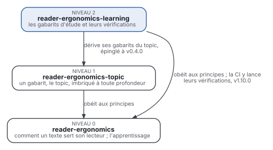

# Supports d'apprentissage

Comment écrire un support fait pour être appris, pour que la personne qui l'étudie seule le retienne et s'en serve
sur des problèmes nouveaux, au moindre coût. Le support, c'est la leçon, l'exemple résolu, la feuille d'exercices, la
fiche de révision, les cartes mémoire, et les questions qu'ils contiennent.

Il étend [reader-ergonomics](https://github.com/Tewf/reader-ergonomics/blob/e8864477a53d713251ba42a4cf7b7a0d761243a2/README.md).
Les principes, leurs niveaux de preuve et les vérifications vivent là-bas et ne sont pas répétés ici. Les effets
d'apprentissage eux-mêmes aussi : récupération en mémoire, espacement, exemples résolus, multimédia. Ce dépôt ajoute
ce que le genre change : comment chacun de ces documents est construit, et ce qu'un programme peut y vérifier.

Cette page en anglais : [README.md](README.md). Les deux versions suivent le même état.

> **État :** la revue de littérature est écrite et auditée (2026-10-29) : quatre revues multivocales, 420 sources,
> dans [evidence](evidence/) ; 304 lignes vérifiées dans leurs sources, un second évaluateur sur une source grise
> sur cinq. Cinq gabarits, leurs vérifications et un exemple de chacun sont écrits ; aucun n'a été testé auprès d'apprenants. C'est une lecture informelle de la
> recherche et de la pratique publiées : ni une norme officielle, ni une étude évaluée par des pairs, ni un résultat
> nouveau, ni une prétention à l'état de l'art.
>
> **Comment il est fait :** avec Claude, un assistant IA d'Anthropic, sous la direction du mainteneur, comme
> reader-ergonomics. Des agents IA rédigent les revues de littérature ; chaque référence est résolue par script, et un
> chiffre lu seulement dans un résumé est marqué « (secondary) ». Les corrections sont bienvenues sous forme d'issues.

## Où il se place



- **Il obéit à reader-ergonomics** et lance ses vérifications, comme toute extension
  ([extending.md](https://github.com/Tewf/reader-ergonomics/blob/e8864477a53d713251ba42a4cf7b7a0d761243a2/extending.md)).
- **Ses gabarits dérivent du
  [topic](https://github.com/Tewf/reader-ergonomics-topic/blob/1220def7863b5e977a3edd1e30bd168fff1523a5/shapes/topic.md)** :
  un titre, un résumé qui tient lieu du document, un corps, son contenu, et ce vers quoi il pointe. Une leçon ou une
  feuille d'exercices ajoute ses propres blocs et n'en retire aucun.
- **Aucun niveau ne dépend d'un niveau au-dessus de lui.** Rien en dessous ne pointe vers ce dépôt.

## Pourquoi il existe

Les preuves sur la façon dont on apprend sont déjà passées en revue. Ce qui manque, c'est le passage de ces preuves aux
documents qu'un apprenant étudie, et un programme qui les vérifie.

| Ce qui existe | Où | Ce qui manque |
|---|---|---|
| les effets d'apprentissage, chacun avec son niveau de preuve et sa taille d'effet | reader-ergonomics, [learning science](https://github.com/Tewf/reader-ergonomics/tree/e8864477a53d713251ba42a4cf7b7a0d761243a2/evidence/learning-science) | comment s'écrit une question, une carte ou une feuille d'exercices |
| des guides en prose pour enseignants et auteurs | guides de pratique et livres, situés par les revues | une vérification qu'un programme peut lancer |
| des gabarits de leçon vérifiés par programme | [The Carpentries Workbench](https://github.com/carpentries/pegboard) | ses vérifications lisent les titres, les blocs et les liens, pas ce que la leçon enseigne |

## Périmètre

| | Quoi | Pourquoi |
|---|---|---|
| dedans | un support écrit étudié seul : une leçon ou un chapitre, une série d'exemples résolus, une feuille d'exercices, une fiche de révision, un paquet de cartes mémoire, et les questions qu'ils contiennent | le lecteur est l'apprenant, et l'objet est le document, comme dans reader-ergonomics |
| dedans | le support qu'un enseignant écrit pour d'autres, et celui que l'apprenant écrit pour lui-même | les deux se lisent de la même façon, seul et de nouveau plus tard |
| dedans | les gabarits de ces documents, et les vérifications qu'un programme peut y lancer | ce qu'un programme peut vérifier, un programme le vérifie |
| dehors | savoir si une technique d'apprentissage marche | passé en revue dans reader-ergonomics, et lié d'ici |
| dehors | l'enseignement en direct : cours magistraux, exposés, programmation en direct | [reader-ergonomics-presentations](https://github.com/Tewf/reader-ergonomics-presentations) |
| dehors | les algorithmes qui planifient les révisions | évalués dans reader-ergonomics ; un paquet en utilise un, ce dépôt n'en construit pas |
| dehors | les tuteurs intelligents, les plateformes et les tuteurs IA | du logiciel et du dialogue, un autre objet |
| dehors | la conception d'examens notés et leur statistique | un autre domaine ; seules les règles qui valent aussi pour une question d'auto-test sont dedans |
| dehors | la conception de programmes et de cursus | l'unité est ici un document, ou le support d'un cours |

## Les quatre revues

Chaque revue demande comment le document est écrit pour qu'une technique atteigne l'apprenant, pas si la technique
marche. Chacune est une [revue de littérature multivocale](evidence/README.md#method) : recherche et pratique ensemble, chaque source grise notée
pour sa qualité.

| Revue | Question | Sources |
|---|---|---|
| [practice-questions](evidence/practice-questions/) | comment s'écrivent, se placent et se corrigent les questions d'un support d'étude | 107 |
| [flashcards](evidence/flashcards/) | comment s'écrivent, se fabriquent et s'entretiennent des cartes à réviser à intervalles espacés | 100 |
| [exercise-sets](evidence/exercise-sets/) | comment une série d'exercices est ordonnée et soutenue, de l'exemple résolu au problème | 117 |
| [instructional-text](evidence/instructional-text/) | comment un texte explicatif se construit autour de son contenu : objectifs, termes, résumés, encadrés | 96 |

Pourquoi quatre, et où chaque travail est passé en revue : [décision 0002](decisions/0002-four-reviews.md).

## Ce que les revues ont trouvé

Chaque ligne renvoie à la revue qui porte ses preuves ; « (secondary) » marque un chiffre lu seulement dans un résumé.

| Document | Ce que les preuves établissent | Niveau | Ce que ces recherches n'ont pas trouvé testé |
|---|---|---|---|
| questions d'entraînement | le test se transfère aux questions d'application et d'inférence (d = 0,32) ; une correction plus informative a plus d'effet ; le moment de la correction ne change rien en moyenne (g = 0,03, secondary) | mesuré | où placer les réponses : repliées, en fin de chapitre, en fin d'ouvrage |
| cartes mémoire | retirer une carte dès qu'elle est sue fait moins retenir ; un grand paquet bat plusieurs petits ; les cartes faites par l'apprenant battent les cartes toutes faites (d = 0,45, secondary), contesté pour le vocabulaire | mesuré ; le dernier contesté | un fait par carte ; texte à trous contre carte à question dans une application de répétition espacée |
| séries d'exercices | mêler les types déjà vus aux devoirs a relevé les notes en classe, à distance (d = 0,79 à 30 jours) ; retirer peu à peu les étapes des exemples résolus bat les paires exemple-problème | mesuré, surtout en mathématiques | une feuille entière construite avec les parties mesurées ; quand donner les corrigés ; des indices sur papier |
| texte explicatif | un texte qui énonce une idée fausse et la réfute bat l'exposé simple (g = 0,36 sur 30 comparaisons) ; les notes guidées relèvent la réussite à l'université (d = 0,55) ; les manuels libres enseignent autant que les manuels commerciaux (g = 0,01) | mesuré | aligner les objectifs sur les vérifications, dans un essai contrôlé ; les fiches de révision |

Chaque revue se termine par des propositions de gabarits et de vérifications, chacune avec son niveau
(`shapes-and-checks.md` dans chaque dossier). Ce sont des propositions : les gabarits seront écrits à partir d'elles.

## Les références que les gabarits doivent battre

| Document | Référence | Comparé aussi à |
|---|---|---|
| questions d'entraînement | un auto-test de questions à réponse courte, la bonne réponse montrée après chaque essai | les questions de fin de chapitre telles qu'un manuel les imprime |
| cartes mémoire | un paquet Anki de cartes question-réponse fait par l'apprenant, avec le planificateur par défaut | un paquet partagé tout fait, sur le même contenu |
| séries d'exercices | la feuille par blocs : une suite de problèmes du même type par leçon, les réponses à la fin | la paire exemple-problème, pour l'entrée d'un nouveau type |
| texte explicatif | une section de manuel libre : objectifs, termes en gras, résumé, vérifications avec corrigé | un épisode Carpentries, pour une leçon seule |

Le `baseline.md` de chaque revue donne le plan de la comparaison : même temps, test différé, questions de transfert.

## Repris des dépôts voisins

Liés à un commit épinglé, jamais copiés ([one place per fact](https://github.com/Tewf/reader-ergonomics/blob/e8864477a53d713251ba42a4cf7b7a0d761243a2/principles/collection/one-place-per-fact.md)).

| De | Quoi | Sert à |
|---|---|---|
| reader-ergonomics | les principes, la revue des sciences de l'apprentissage, les vérifications, la feuille de style, le contrat des extensions, le gabarit de fiche de décision | chaque document d'ici ; [decisions](decisions/) ; la CI |
| reader-ergonomics-topic | le topic, base de chaque gabarit, et sa vérification ; la méthode de revue de ses trois revues | les [gabarits](shapes/README.md) ; la CI ; les quatre revues |
| reader-ergonomics-software-design | la méthode de lecture des sites de questions-réponses | le volet Q/R de chaque revue |
| reader-ergonomics-presentations | l'enseignement en direct, qui reste là-bas ; des contextes qui surchargent une base pour un public | la frontière ; un modèle pour les vitesses de lecture d'une fiche de révision, à tester |

## Contenu

| Partie | Contient |
|---|---|
| [shapes](shapes/README.md) | les cinq gabarits des documents d'étude, chacun avec les preuves de ses blocs, ses vérifications et un exemple |
| [decisions](decisions/) | une fiche par choix qui façonne ce dépôt, chacune ouverte par la décision en une phrase |
| [evidence](evidence/) | les quatre revues, 420 sources, et la bibliographie de 452 travaux |

## Suite

1. Lire par l'université les cinq sources payantes, pour les lignes que l'audit n'a pas pu vérifier.
2. Les tester sur de vrais supports d'étude : les livres de solutions expliquées de
   [University-Coursework](https://github.com/Tewf/University-Coursework).

## Le vérifier

```sh
git clone https://github.com/Tewf/reader-ergonomics
python3 reader-ergonomics/checks/run.py chemin/vers/ce/depot
```

La CI lance les mêmes vérifications à chaque envoi, et une exécution échoue à la moindre erreur ([checks.yml](https://github.com/Tewf/reader-ergonomics-learning/blob/master/.github/workflows/checks.yml)).
Chaque envoi sur master construit aussi le site, [tewf.github.io/reader-ergonomics-learning](https://tewf.github.io/reader-ergonomics-learning/)
([pages.yml](https://github.com/Tewf/reader-ergonomics-learning/blob/master/.github/workflows/pages.yml)).

## Licence

Le code sous [Apache License 2.0](LICENSE) ; la prose sous [CC BY 4.0](LICENSES/CC-BY-4.0.txt). Réutilisez-le
librement, en citant ce dépôt ; [CITATION.cff](CITATION.cff) donne une citation si besoin.
