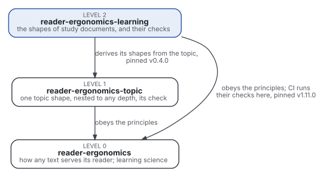

# Learning materials

[](https://github.com/Tewf/reader-ergonomics-learning/actions/workflows/checks.yml?query=branch%3Amaster)
[](https://tewf.github.io/reader-ergonomics-learning/)

How to write material meant to be learned, so that someone who studies it alone retains it and uses it on new
problems, at the least cost. The material is the lesson, the worked example, the exercise sheet, the study guide, the
flashcards, and the questions inside them.

It extends [reader-ergonomics](https://github.com/Tewf/reader-ergonomics/blob/d48ffbe96aed32dd63e1974ee60f69472fe36932/README.md).
The principles, their grades and the checks live there and are not repeated here. So do the learning effects
themselves: retrieval, spacing, worked examples, multimedia. This repository adds what the genre changes: how each of
these documents is built, and what a program can check in it.

This page in French: [README.fr.md](README.fr.md).

> **Status:** the literature review is written and audited (2026-10-29): four multivocal reviews, 420 sources, in
> [evidence](evidence/); 304 lines checked against their sources, a second rater on every fifth grey source. Five
> shapes, their checks and an example of each are written; no shape has been tested on learners. It is an informal reading of published research and practice: not an
> official standard, not a peer-reviewed study, not a new result, and not a claim to the state of the art.
>
> **How it is made:** with Claude, an AI assistant by Anthropic, under the maintainer's direction, the way
> reader-ergonomics was made. AI agents draft the literature reviews; every reference is resolved by script, and a
> number read only in a summary is marked "(secondary)". Corrections are welcome as issues.

## Where it sits



- **It obeys reader-ergonomics** and runs its checks, as every extension does
  ([extending.md](https://github.com/Tewf/reader-ergonomics/blob/d48ffbe96aed32dd63e1974ee60f69472fe36932/extending.md)).
- **Its shapes derive from the
  [topic](https://github.com/Tewf/reader-ergonomics-topic/blob/1220def7863b5e977a3edd1e30bd168fff1523a5/shapes/topic.md)**:
  a title, a summary that stands for the document, a body, its contents, and what it points to. A lesson or an
  exercise sheet adds its own blocks and removes none.
- **No level depends on a level above it.** Nothing below links up to this repository.

## Why it exists

The evidence on how people learn is reviewed already. What is missing is the step from that evidence to the documents
a learner studies, and a program that checks them.

| What exists | Where | What it leaves out |
|---|---|---|
| the learning effects, each with its grade and its effect size | reader-ergonomics, [learning science](https://github.com/Tewf/reader-ergonomics/tree/d48ffbe96aed32dd63e1974ee60f69472fe36932/evidence/learning-science) | how a question, a card or an exercise sheet is written |
| guides in prose for teachers and authors | practice guides and books, placed by the reviews | a check a program can run |
| lesson templates checked by a program | [The Carpentries Workbench](https://github.com/carpentries/pegboard) | its checks read headings, blocks and links, not what the lesson teaches |

## Scope

| | What | Why |
|---|---|---|
| in | written material studied alone: a lesson or chapter, a set of worked examples, an exercise sheet, a study guide, a deck of flashcards, and the questions inside them | the reader is the learner, and the document is the object, as in reader-ergonomics |
| in | material a teacher writes for others, and material learners write for themselves | both are read the same way, alone and again later |
| in | the shapes of these documents, and the checks a program can run on them | what a program can check, a program checks |
| out | whether a learning technique works | reviewed in reader-ergonomics, and linked from here |
| out | teaching live: lectures, talks, live coding | [reader-ergonomics-presentations](https://github.com/Tewf/reader-ergonomics-presentations) |
| out | the algorithms that schedule reviews | benchmarked in reader-ergonomics; a deck uses one, this repository does not build one |
| out | tutoring systems, platforms and AI tutors | software and dialogue, another object |
| out | exam design for grading and its statistics | another field; only the rules that also hold for a self-test question are in |
| out | programme and curriculum design | the unit here is a document, or the material of one course |

## The four reviews

Each review asks how the document is written so that a technique reaches the learner, not whether the technique
works. Each is a [multivocal literature review](evidence/README.md#method): research and practice together, every grey source scored for quality.

| Review | Question | Sources |
|---|---|---|
| [practice-questions](evidence/practice-questions/) | how the questions inside study material are written, placed and answered | 107 |
| [flashcards](evidence/flashcards/) | how prompts for spaced review are written, made and kept | 100 |
| [exercise-sets](evidence/exercise-sets/) | how a set of exercises is ordered and supported, from worked example to problem | 117 |
| [instructional-text](evidence/instructional-text/) | how an explanatory text is built around its content: objectives, terms, summaries, boxes | 96 |

Why four, and where each work is reviewed: [decision 0002](decisions/0002-four-reviews.md).

## What the reviews found

Each line links the review that holds its evidence; "(secondary)" marks a number read only in a summary.

| Document | What the evidence settles | Grade | What these searches did not find tested |
|---|---|---|---|
| practice questions | testing transfers to application and inference questions (d = 0.32); feedback with more information has larger effects; when feedback comes makes no average difference (g = 0.03, secondary) | measured | where the answers sit: folded, at the end of the chapter, at the back |
| flashcards | dropping a card once it is recalled lowers retention; one large stack beats several small ones; learner-made cards beat premade ones (d = 0.45, secondary), contested for vocabulary | measured; the last contested | one fact per card; fill-in-the-blank against question cards inside a spaced repetition app |
| exercise sets | mixing earlier types into homework raised delayed classroom scores (d = 0.79 at 30 days); fading the steps of worked examples beats example-problem pairs | measured, mostly mathematics | a whole sheet built from the measured parts; when to release solutions; hints on paper |
| instructional text | a text that states a misconception and refutes it beats plain exposition (g = 0.36 over 30 comparisons); guided notes raise college achievement (d = 0.55); open textbooks teach as much as commercial ones (g = 0.01) | measured | aligning objectives with the checks, in a controlled trial; revision guides |

Every review ends in proposals for the shapes and the checks, each with its grade (`shapes-and-checks.md` in each
folder). They are proposals: the shapes will be written from them.

## The baselines the shapes must beat

| Document | Baseline | Also compared with |
|---|---|---|
| practice questions | a self-test of short-answer recall questions, the correct answer shown after each attempt | end-of-chapter questions as a textbook prints them |
| flashcards | a [learner-made deck](evidence/flashcards/frame.md) of question-and-answer cards in Anki, under its default scheduler | a ready-made shared deck of the same content |
| exercise sets | the blocked sheet: one run of same-type problems per lesson, answers at the end | the example-problem pair, for how a new type opens |
| instructional text | an open-textbook section: objectives, bold terms, a summary, checks with a key | a Carpentries episode, for a single lesson |

Each review's `baseline.md` gives the design of the comparison: matched time, a delayed test, transfer items.

## Brought from the sibling repositories

Linked at a pinned commit, never copied ([one place per fact](https://github.com/Tewf/reader-ergonomics/blob/d48ffbe96aed32dd63e1974ee60f69472fe36932/principles/collection/one-place-per-fact.md)).

| From | What | Used for |
|---|---|---|
| reader-ergonomics | the principles, the learning-science review, the checks, the stylesheet, the extension contract, the decision-record shape | every document here; [decisions](decisions/); CI |
| reader-ergonomics-topic | the topic, base of every shape, and its check; the review method its three reviews share | the [shapes](shapes/README.md); CI; the four reviews |
| reader-ergonomics-software-design | the method for reading question-and-answer sites | the Q/A strand of each review |
| reader-ergonomics-presentations | teaching live, which stays there; contexts that override a base for one audience | the boundary; a model for the reading speeds of a study guide, to be tested |

## Contents

| Part | Holds |
|---|---|
| [shapes](shapes/README.md) | the five shapes of study documents, each with the evidence behind its blocks, its checks and an example |
| [decisions](decisions/) | one record per choice that shapes this repository, each opening with the decision in one sentence |
| [evidence](evidence/) | the four reviews, 420 sources, and the bibliography of 452 works |

## Next

1. Read the five paywalled sources through the university, for the rows the audit could not verify.
2. Test the shapes on real study material: the explained solution books of
   [University-Coursework](https://github.com/Tewf/University-Coursework).

## Check it

```sh
git clone https://github.com/Tewf/reader-ergonomics
python3 reader-ergonomics/checks/run.py path/to/this/repository
```

CI runs the same checks on every push, and a run fails on any error ([checks.yml](https://github.com/Tewf/reader-ergonomics-learning/blob/master/.github/workflows/checks.yml)).
Every push to master also renders the site, [tewf.github.io/reader-ergonomics-learning](https://tewf.github.io/reader-ergonomics-learning/)
([pages.yml](https://github.com/Tewf/reader-ergonomics-learning/blob/master/.github/workflows/pages.yml)).

## Licence

Code under the [Apache License 2.0](LICENSE); prose under [CC BY 4.0](LICENSES/CC-BY-4.0.txt). Reuse it as you wish,
with credit to this repository; [CITATION.cff](CITATION.cff) gives a citation if you need one.
