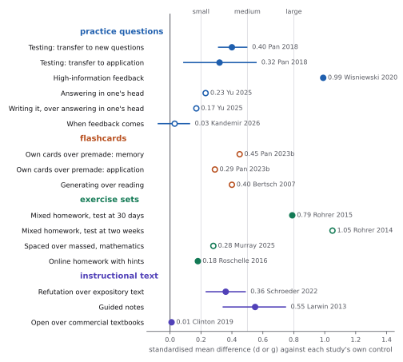

# Evidence

Four literature reviews, one per kind of study document, each in the steps reader-ergonomics uses for its own
[evidence](https://github.com/Tewf/reader-ergonomics/tree/adb53c52fa8eefe0e621e520365157bbbcad1a1a/evidence): frame,
review, state of the art, position, the case against, baseline. Written and audited on 2026-10-29.

## Contents

| Review | Question | Sources |
|---|---|---|
| [practice-questions](practice-questions/) | how the questions inside study material are written, placed and answered | 107 |
| [flashcards](flashcards/) | how prompts for spaced review are written, made and kept | 100 |
| [exercise-sets](exercise-sets/) | how a set of exercises is ordered and supported, from worked example to problem | 117 |
| [instructional-text](instructional-text/) | how an explanatory text is built around its content: objectives, terms, summaries, boxes | 96 |

Every work cited is listed once in the [bibliography](bibliography.md): 452 works, with the ones the reviews link in the
standard.

## The pool

| | practice-questions | flashcards | exercise-sets | instructional-text | all |
|---|---|---|---|---|---|
| formal, new | 73 | 69 | 78 | 69 | 289 |
| grey, new | 23 | 31 | 39 | 27 | 120 |
| of which Q/A threads | 15 | 19 | 29 | 14 | 77 |
| grey examples only (below 10 of 20 for either rater) | 1 | 6 | 12 | 8 | 27 |
| carried from the core (9) or a sibling review (2) | 11 | 0 | 0 | 0 | 11 |
| in the review | 107 | 100 | 117 | 96 | 420 |

- Most formal sources were read by abstract; each review's `sources.md` says which were read in full.
- Each review keeps the form most used in practice apart from the best tested one. Practice counts as evidence only
  where a study measured its effect.

## The measured effects

- A filled dot was read in the full text, an open one only in an abstract or a summary; a bar is the 95% interval,
  where the source gives one. Small, medium and large are 0.2, 0.5 and 0.8.
- Each effect is against its own study's control, so the rows are not a ranking: 0.99 for informative feedback and
  0.79 for mixed homework answer different questions. The values and their keys are those of the audited reviews.

## Method

Each review is a **multivocal literature review**: research and **grey literature** (standards, publishers' and
open textbook guides, practitioner books, tools, question-and-answer sites) in one review, built to a written protocol
after Garousi 2019. The rules the four share are those of the reviews of reader-ergonomics-topic, linked rather than
repeated: [its method](https://github.com/Tewf/reader-ergonomics-topic/blob/1220def7863b5e977a3edd1e30bd168fff1523a5/evidence/README.md#method).

Two rules differ here:

- **ERIC.** Education research is indexed first in ERIC, the database of the US Institute of Education Sciences, so
  every formal string is counted there, by phrase, through its public interface. It is the primary count.
- **OpenAlex** counted each formal string afterwards by script, on 2026-10-29, in titles and abstracts, as a phrase
  search. The counts sit in each protocol's formal table; the strings, in OpenAlex syntax, in each `openalex.tsv`.

Each review also holds two files the reviews of the siblings do not:

| File | What it holds |
|---|---|
| `shapes-and-checks.md` | what its evidence implies for the shapes of study documents and for checks, each with a grade: proposals, not decisions |
| `handoff.md` | the works met there that belong to another of the four, passed on rather than reviewed twice |

## Rules the four reviews share

Each protocol links here for these rules and states only what is its own: its questions, strings, counts, stopping
point, outlet tiers and exclusions.

- **Quality of a grey source:** Garousi's 20 criteria, each scored 1, 0.5 or 0, in eight groups: authority (4),
  methodology (6), objectivity (4), date (1). The rest: position among related sources (1), novelty (2), impact (1),
  outlet tier (1). The `sources.md` tables give the subtotals in that order.
- **Threshold: 10 of 20.** Below it a source is an **example of practice** only, never support for a claim. A part
  of a source that was not seen scores 0, so a book known only from its catalogue record scores low for that reason.
- **Question-and-answer threads:** read through the Stack Exchange API, top 30 by votes per string and site
  (`order=desc&sort=votes&pagesize=30`, endpoint `search/advanced`, version 2.3, no key, no login), after the
  [Q/A method](https://github.com/Tewf/reader-ergonomics-software-design/blob/master/evidence/architecture-descriptions/protocol.md#qa-sites)
  of reader-ergonomics-software-design. A thread whose title bears on a question of the review is opened, and its
  question and two top answers are read.
- **Scoring a thread:** authority 0.5 for a moderated, peer-voted site; the top answerer's reputation 1 at 20,000
  and 0.5 at 5,000. Impact 1 at 20,000 views or 30 votes, 0.5 at 3,000 views or 10 votes; outlet 0.5; date 1.
  Display names are not recorded: a thread is cited by site, year and number.
- **Why grey literature:** each protocol answers the seven questions of Garousi 2019, Table 4; one yes suggests
  including it.
- **Synthesis** is narrative, by the review's questions, and every claim traces to a row of its `sources.md`.

## The principles of the standard these reviews serve

Linked here once; a review names them without repeating the links.

| Principle | Served by |
|---|---|
| [retrieval prompts](https://github.com/Tewf/reader-ergonomics/blob/adb53c52fa8eefe0e621e520365157bbbcad1a1a/principles/document/retrieval-prompts.md) | all four |
| [worked examples with subgoals](https://github.com/Tewf/reader-ergonomics/blob/adb53c52fa8eefe0e621e520365157bbbcad1a1a/principles/document/worked-examples-with-subgoals.md) | exercise-sets, practice-questions, instructional-text |
| [define before use](https://github.com/Tewf/reader-ergonomics/blob/adb53c52fa8eefe0e621e520365157bbbcad1a1a/principles/document/define-before-use.md) | instructional-text |
| [overview first](https://github.com/Tewf/reader-ergonomics/blob/adb53c52fa8eefe0e621e520365157bbbcad1a1a/principles/document/overview-first.md) | instructional-text |
| [signal the structure](https://github.com/Tewf/reader-ergonomics/blob/adb53c52fa8eefe0e621e520365157bbbcad1a1a/principles/page/signal-the-structure.md) | instructional-text |
| [one place per fact](https://github.com/Tewf/reader-ergonomics/blob/adb53c52fa8eefe0e621e520365157bbbcad1a1a/principles/collection/one-place-per-fact.md) | instructional-text |

## What these reviews do not repeat

Whether a technique works is reviewed in the standard
([decision 0001](../decisions/0001-take-the-document-not-the-technique.md)). These reviews link it, with one line of
context, and add how the document delivers it.

## Audit

Every line carrying a number, and every claim graded measured, was checked against its primary source on 2026-10-29,
one auditor per review, none of whom wrote it. Counts of each README and flow were checked by arithmetic.

| Review | Rows | Correct | Imprecise | Wrong | Unverifiable | Repeats |
|---|---|---|---|---|---|---|
| practice-questions | 89 | 69 | 6 | 1 | 5 | 8 |
| flashcards | 74 | 57 | 5 | 1 | 0 | 11 |
| exercise-sets | 86 | 69 | 10 | 1 | 0 | 6 |
| instructional-text | 55 | 41 | 9 | 1 | 0 | 4 |
| all | 304 | 236 | 30 | 4 | 5 | 29 |

- Every wrong and imprecise row is corrected; each wrong row was checked again in its source before the correction
  was written, since a correction is a claim too.
- The four wrong rows:
  - the front page said no study had compared fill-in-the-blank with question cards, which Kim 2023 did;
  - an indexer's summary of Paas 1992 reversed the author's own finding;
  - one textbook's question count was given for every chapter, from its first;
  - a count of screened titles disagrees with the review's own rule, and both are now stated.
- The five unverifiable rows rested on three paywalled papers, sent to the university. Hattie 2007 came back and its
  two rows are correct, Table 1 giving 40 effects for Bangert-Drowns 1991. Rowland 2014 and Yang 2021 are published by
  APA, to which the university has no subscription: their three rows stay marked as not checked. Reder 1980, read
  the same way, now gives the result the review could not state before.
- The audit also lowered three grades to what their evidence allows and restored missing "(secondary)" marks.
- It found 28 rows of one protocol table shifted by the script that added the OpenAlex column; they were rebuilt
  from the recorded counts.

## Second rater

A second rater re-scored, blind, every fifth grey source of the four reviews: 23 sources, all of them read.

- Inclusion: the raters agreed on 21 of 23, Cohen's kappa 0.78, unstable at this size (bootstrap 0.43 to 1.00).
- Totals: mean absolute difference 1.35 of 20, the second rater 0.61 points lower.
- The raters differed most on methodology (1.07) and objectivity (0.65), least on outlet tier (0.02).
- Two sources fell below 10 for the second rater, and are now examples of practice only: NBME 2026 (12 against 6.5,
  read by its landing page) and AcSE 2023 (11 against 8.5).

## Other checks

- Every DOI in the four reviews resolved on Crossref on 2026-10-29. Where Crossref's year differs from a key's, the
  key gives the year of print and Crossref the year online.
- Every key was checked by script against the five bibliographies of the family. No work here carries a key another
  repository gives a different work, except Yang 2021. It names the standard's work here and another work in
  reader-ergonomics-presentations, a clash between the two siblings.
- One citation in reader-ergonomics was found wrong here and corrected there, in v1.3.1 (Dickson 2005).

## See also

The [repository's front page](../README.md), the parent of this folder; [decision 0002](../decisions/0002-four-reviews.md)
for why there are four reviews.
