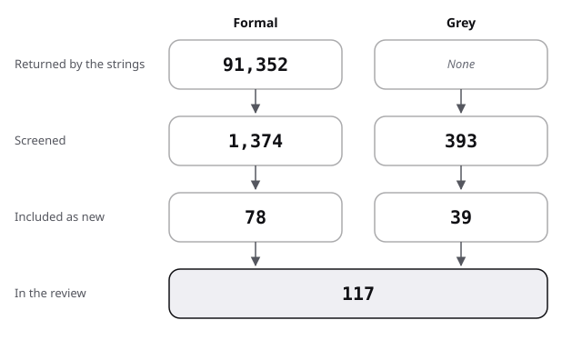

# Sources: the pool, the flow and the scores

The pool of the exercise-sets review: how it narrowed, then one row per source. Strings and rules: [protocol](protocol.md).

## Flow

| Stage | Formal | Grey |
|---|---|---|
| Returned by the strings | 91,352 | not recorded |
| Screened | 1,374 | 393 |
| Included as new | 78 | 39 |
| In the review | 78 | 39 |

- Formal:
  - 91,352 records were returned: ERIC 2,969 over 37 strings, Semantic Scholar 88,340 over 35 strings, arXiv 43 over 7 strings.
  - Semantic Scholar matches words, so its total is mostly noise: one string alone (F22) returned 67,786.
  - 1,374 titles were screened, with repeats across strings: 631 ERIC, 700 Semantic Scholar, 43 arXiv.
  - 78 were included: 74 from the strings, 2 leads found by title (Cooper 2006, Sweller 1985), 2 by forward snowballing (Cox 2024, Rieger 2016).
- Grey:
  - The web strings and direct visits gave 73 results screened; the Q/A strings 320 records, every title read.
  - 39 were included: 8 from the web, 2 What Works Clearinghouse reports found through ERIC string F28, and 29 Q/A threads.
- Linked, not reviewed: 13 works already reviewed in the core repository (table below), and the method source Garousi 2019.
- Formal exclusions: of the 1,374 screened titles, 74 distinct sources were included and the rest, repeats among them, were excluded; the count per reason was not recorded. The reasons, by title: repeats across strings; other fields (motor learning and sport, matrix completion, vehicle routing, clinical work); education but off-topic (parental involvement, flipped classrooms, school leadership, attitudes to AI). Also: feedback and question format, passed to practice-questions ([handoff](handoff.md)); effects held by the core; relevant but unreadable by abstract.
- Grey exclusions: 65 web results and 291 Q/A records were not included; the count per reason was not recorded. The reasons: secondary write-ups of the same report, school and vendor pages restating guidance, pages refused or missing (Runestone, the MAA WeBWorK page), and Q/A threads off-topic, how-to, or about grading policy.

## Formal sources

"abstract" means the abstract was read and numbers from it are marked "(secondary)" in the text.

| Key | Kind | Found via | Quality | Used in |
|---|---|---|---|---|
| Firth 2021 | formal | F1 | systematic review, 26 studies, abstract | review, position, against |
| Chen 2021 | formal | F1 | systematic review, abstract | review |
| Murray 2025 | formal | F31 | meta-analysis, 27 studies, abstract | frame, review, state of the art, position, against |
| Atkinson 2000 | formal | F10 | review, abstract | frame, review |
| Muldner 2022 | formal | F2 | review, abstract | review, position |
| Du 2020 | formal | F2 | review, abstract | frame, review, state of the art, position, against |
| Ericson 2022 | formal | F2 | systematic review, abstract | review, position |
| Cooper 2006 | formal | lead (ERIC title) | research synthesis, abstract | frame, review, position, against, protocol |
| Bas 2017 | formal | F3 | meta-analysis, abstract | review, position, against |
| Fan 2017 | formal | F3 | meta-analysis, title and venue only | review, protocol |
| Bishop 2024 | formal | F3 | meta-analysis, 18 studies, abstract | review, state of the art, against |
| Aleven 2003 | formal | F15; lead | review, abstract | frame, review, protocol |
| Aleven 2016 | formal | F15 | review with a classroom study, abstract | review, state of the art, against |
| Sweller 1985 | formal | lead (Crossref title) | experiments, title and venue only | frame, review, protocol |
| van Merriënboer 1990 | formal | F8; lead | experiment, abstract (no result stated) | frame, review, protocol |
| Paas 1992 | formal | F8 | measured, experiment, 46 students, abstract | review, state of the art |
| Rohrer 2007 | formal | F5; lead | measured, two experiments, abstract | frame, review, protocol |
| Parsons 2006 | formal | F2; lead | tool and format, title and venue only | frame, review, protocol |
| Bjork 1994 | formal | F13 (the term); lead | chapter, not opened | frame, review, protocol |
| Rohrer 2009 | formal | F5 | review, abstract | frame, review, baseline |
| Rohrer 2012 | formal | A1 | review, abstract | against |
| Rohrer 2014 | formal | F4 | measured, classroom experiment, 140 students, abstract | review, state of the art, position, against, baseline |
| Rohrer 2015 | formal | F4; lead | measured, classroom experiment, 126 students, read in full | frame, review, state of the art, position, against, baseline, protocol |
| Rohrer 2020b | formal | F4 | measured, descriptive, 13,505 problems, read in full | review, state of the art, position, against, baseline, protocol |
| Rohrer 2020c | formal | A1 | commentary, abstract | frame, review, position |
| Ostrow 2015 | formal | F22 | measured, randomised homework session, abstract | review |
| Rau 2013 | formal | F4 | measured, classroom experiment, 158 pupils, abstract | review |
| Nemeth 2023 | formal | F4 | measured, randomised, 236 pupils, abstract | review |
| Gulacar 2022 | formal | F13 | measured, two groups, abstract | frame, review, protocol |
| Cox 2024 | formal | snowball, forward from Gulacar 2022 | two cohorts, not randomised, abstract | review, protocol |
| Emeny 2021 | formal | F31 | measured, two classroom experiments, abstract | review, position, against, baseline |
| Hartwig 2022 | formal | F4 | measured, descriptive, 193 and 175 students, abstract | review, position, against |
| van der Haar 2023 | formal | F4 | measured, cluster trial, 62 classrooms, working paper, abstract | review, state of the art, against, baseline |
| Gorgievski 2024 | formal | F5 | measured, course comparison, abstract | review, state of the art, position, against |
| Crissinger 2015 | formal | F31 | measured, randomised sections, abstract | review, against |
| Bego 2024 | formal | F31 | measured, nine courses, abstract | review, against |
| Agodini 2010 | formal | F28 | measured, cluster trial, 39 schools, abstract | review, against |
| Agodini 2013 | formal | F28 | measured, two-year follow-up, abstract | against |
| Renkl 2002 | formal | F9 | measured, three samples, abstract | review, state of the art, position, baseline |
| Atkinson 2003 | formal | F7; lead | measured, two experiments, abstract | frame, review, state of the art, position, baseline, protocol |
| Kissane 2008 | formal | F7 | measured, workplace classroom, abstract | review |
| Salden 2009 | formal | F7 | measured, lab and classroom, abstract | review, state of the art, position |
| Jennings 2020 | formal | F9 | measured, experiment, abstract | review, against |
| Zamary 2018 | formal | F7 | measured, two experiments, 146 and 131, abstract | against |
| Miller-Cotto 2019 | formal | F7 | measured, classroom, 135 students, abstract | against |
| Foster 2018 | formal | F7 | measured, three experiments, abstract | review, against |
| van Gog 2011b | formal | F9 | measured, 32 participants, abstract | review, state of the art, against |
| Coppens 2019 | formal | F9 | measured, 126 pupils, abstract | review |
| van Harsel 2019 | formal | F9 | measured, two experiments, 124 and 81, abstract | review, against |
| Ganaiem 2025 | formal | F9 | measured, 156 students, abstract | review, state of the art, against |
| Ericson 2017 | formal | F2; lead | measured, title and venue; result as Ericson 2018 reports it | review, position, protocol |
| Ericson 2018 | formal | F2 | measured, abstract | frame, review, state of the art, position, baseline |
| Haynes 2021 | formal | F2 | measured, within-subjects, abstract | review, position, against |
| Harms 2016 | formal | F2 | measured, title and venue only | review, against, protocol |
| Hou 2025 | formal | X1 | measured, 118 students, preprint, read in full | review, against, protocol |
| Likourezos 2019 | formal | F11 | measured, two experiments, 103 and 56, abstract | frame, review, state of the art, against, baseline |
| Jansen 2013b | formal | F12 | measured, 207 children, abstract | frame, review, state of the art, against |
| Pardos 2009 | formal | F24 | measured, log analysis, abstract | review |
| Tian 2021 | formal | F29 | measured, textbook analysis and three datasets, abstract | review |
| Lithner 2003 | formal | F29 | descriptive, video of three students, abstract | review |
| Roll 2011 | formal | F15 | measured, two classroom studies, 58 and 67, abstract | review, state of the art, baseline |
| Baker 2008 | formal | F16 | measured, four studies, abstract | frame, review |
| Vanacore 2024 | formal | F16 | measured, randomised, abstract | review, against |
| Marwan 2019 | formal | F30 | measured, two studies, abstract | review |
| Pardos 2024 | formal | F35 | measured, randomised, N = 274, abstract | review, against |
| Bastani 2025 | formal | F35 | measured, field experiment, about 1,000 students, abstract | review, state of the art, against |
| Rystrom 2005 | formal | F18 | two cohorts, one instructor, abstract | frame, review, state of the art, position, against |
| Palazzo 2010 | formal | F17; lead | measured, descriptive, log analysis, abstract | frame, review, state of the art, position, baseline, protocol |
| Glass 2020 | formal | F17 | measured, descriptive, 2,433 students, abstract | review, against |
| Chen 2022 | formal | F17 | measured, descriptive, one course, abstract | review, against, baseline |
| Lancaster 2021 | formal | F34 | measured, descriptive, site data, abstract | frame, review, position |
| Pickering 2024 | formal | F34 | measured, descriptive, audit, abstract | review |
| Rohrer 2006 | formal | F21 | measured, two experiments, 216 students, abstract | review, state of the art, position |
| Trautwein 2007 | formal | F33 (author follow-up) | measured, three correlational studies, abstract | frame, review |
| Roschelle 2016 | formal | F22 | measured, randomised field trial, 2,850 students, read in full | frame, review, state of the art, position, against, baseline, protocol |
| Murphy 2020 | formal | F22 | measured, same trial, abstract | review |
| Kontur 2015 | formal | X4 | measured, correlational, five semesters, arXiv abstract | review, against, protocol |
| Rieger 2016 | formal | snowball, forward from Kontur 2015 | correlational comment, two courses, abstract | review, against, protocol |

## Linked from the core, not reviewed again

| Key | Reviewed in | Used in |
|---|---|---|
| Brunmair 2019 | reader-ergonomics learning-science | frame, review, position |
| Renkl 2004 | reader-ergonomics learning-science | frame, review, position |
| Barbieri 2023 | reader-ergonomics learning-science | frame, review |
| Costa 2022 | reader-ergonomics learning-science | frame, review |
| Paas 1994 | reader-ergonomics learning-science | frame, review, state of the art |
| Latimier 2021 | reader-ergonomics learning-science | frame |
| Cepeda 2008 | reader-ergonomics learning-science | frame |
| Tetzlaff 2025 | reader-ergonomics learning-science | frame, baseline |
| Kulik 1990 | reader-ergonomics learning-science | frame |
| van Gog 2011 | reader-ergonomics reading-order | frame, review, state of the art, position, baseline, shapes, protocol |
| Rohrer 2020 | reader-ergonomics reading-order | frame, review, state of the art, position, protocol |
| Carvalho 2014 | reader-ergonomics reading-order | frame, against |
| Wickens 2013 | reader-ergonomics reading-order | frame |

## Grey sources, scored

Subtotals in the order of the [shared rules](../README.md#rules-the-four-reviews-share).

| Key | Kind | Found via | Quality (total, then subtotals) | Used in |
|---|---|---|---|---|
| Pashler 2007 | grey tier 1 | G1 | 18.5 of 20 (4 / 5.5 / 3.5 / 1 / 1 / 1.5 / 1 / 1) | review 1, 3, 7; state of the art; baseline; protocol |
| Perry 2021 | grey tier 1 | G2 | 18 of 20 (4 / 5 / 3.5 / 1 / 1 / 1.5 / 1 / 1) | review 0, 3, 7; state of the art; position; against; baseline; protocol |
| WWC 2016 | grey tier 1 | F28 (ERIC) | 17 of 20 (4 / 4.5 / 4 / 1 / 1 / 0.5 / 1 / 1) | review 2; against |
| WWC 2017 | grey tier 1 | F28 (ERIC) | 17 of 20 (4 / 4.5 / 4 / 1 / 1 / 0.5 / 1 / 1) | frame; review 2; against |
| OpenStax 2026 | grey tier 1 | P | 13.5 of 20 (3.5 / 3 / 3 / 1 / 0 / 1 / 1 / 1) | frame; review 7; state of the art; position; baseline |
| NCETM 2020 | grey tier 2 | G3 | 12 of 20 (3.5 / 2.5 / 2 / 1 / 0.5 / 1.5 / 0.5 / 0.5) | frame; review 4, 7; state of the art; position |
| Chegg 2025 | grey tier 2 | G5 | 12 of 20 (3.5 / 3 / 2 / 1 / 0 / 1 / 1 / 0.5) | review 7; state of the art |
| WeBWorK 2026 | grey tier 2 | G4 | 10 of 20 (3 / 2 / 1.5 / 1 / 0.5 / 0.5 / 1 / 0.5) | review 7; state of the art |
| Project Euler 2026 | grey tier 2 | P | 9 of 20 (2.5 / 2 / 2 / 0 / 0 / 1 / 1 / 0.5) | review 7; state of the art (example only) |
| ASSISTments 2026 | grey tier 2 | P | 7 of 20 (2.5 / 1.5 / 0.5 / 0.5 / 0 / 0.5 / 1 / 0.5) | review 7; state of the art; against (example only) |
| MathEd 2014a | grey tier 2 | ES5 | 11.5 of 20 (1 / 3 / 3.5 / 1 / 0 / 1.5 / 1 / 0.5) | review 8 |
| MathEd 2014b | grey tier 2 | ES5 | 10.5 of 20 (1 / 2.5 / 3.5 / 1 / 0.5 / 1 / 0.5 / 0.5) | review 8; against |
| MathEd 2014c | grey tier 2 | ES6 | 11.5 of 20 (1.5 / 2.5 / 4 / 1 / 0.5 / 1 / 0.5 / 0.5) | review 8; against |
| MathEd 2014d | grey tier 2 | ES5 | 9 of 20 (1 / 2 / 3 / 1 / 1 / 0.5 / 0 / 0.5) | review 8 (example only) |
| MathEd 2014e | grey tier 2 | ES23 | 11.5 of 20 (2 / 2 / 3.5 / 1 / 1 / 1 / 0.5 / 0.5) | review 8 |
| MathEd 2014f | grey tier 2 | ES23 | 10 of 20 (2 / 2 / 3.5 / 1 / 0 / 1 / 0 / 0.5) | frame; review 8; state of the art; position; baseline |
| MathEd 2014g | grey tier 2 | ES5 | 9.5 of 20 (1 / 2.5 / 3 / 1 / 0 / 1 / 0.5 / 0.5) | review 8; state of the art (example only) |
| MathEd 2015a | grey tier 2 | ES5 | 10.5 of 20 (1 / 2.5 / 3.5 / 1 / 0 / 1.5 / 0.5 / 0.5) | review 8 |
| MathEd 2016a | grey tier 2 | ES18 | 10 of 20 (1 / 2.5 / 3 / 1 / 0.5 / 1.5 / 0 / 0.5) | review 8; against |
| MathEd 2016b | grey tier 2 | ES19 | 10 of 20 (1.5 / 2 / 3.5 / 1 / 0.5 / 1 / 0 / 0.5) | review 8; against |
| MathEd 2017a | grey tier 2 | ES6 | 11 of 20 (1.5 / 2.5 / 3.5 / 1 / 0 / 1.5 / 0.5 / 0.5) | review 8; state of the art |
| MathEd 2019a | grey tier 2 | ES18 | 9 of 20 (1 / 2 / 3.5 / 1 / 0 / 1 / 0 / 0.5) | review 8 (example only) |
| MathEd 2020a | grey tier 2 | ES6 | 10.5 of 20 (1 / 2.5 / 3 / 1 / 0.5 / 1.5 / 0.5 / 0.5) | review 8 |
| MathEd 2021a | grey tier 2 | ES6 | 10 of 20 (1.5 / 2 / 3.5 / 1 / 0.5 / 1 / 0 / 0.5) | review 8 |
| MathEd 2021b | grey tier 2 | ES6 | 7 of 20 (1 / 1.5 / 2 / 1 / 0 / 1 / 0 / 0.5) | review 8; protocol (example only) |
| MathEd 2022a | grey tier 2 | ES1 | 9.5 of 20 (1 / 2 / 3 / 1 / 1 / 0.5 / 0.5 / 0.5) | review 8 (example only) |
| MathEd 2022b | grey tier 2 | ES6 | 8.5 of 20 (1.5 / 1.5 / 2.5 / 1 / 0.5 / 1 / 0 / 0.5) | review 8 (example only) |
| MathEd 2023a | grey tier 2 | ES7 | 12 of 20 (1.5 / 2.5 / 3.5 / 1 / 0.5 / 1.5 / 1 / 0.5) | review 8 |
| MathEd 2024a | grey tier 2 | ES18 | 8.5 of 20 (1 / 1.5 / 3 / 1 / 0 / 1 / 0.5 / 0.5) | review 8 (example only) |
| CSEd 2017d | grey tier 2 | ES8 | 10 of 20 (1.5 / 2.5 / 3 / 1 / 0.5 / 1 / 0 / 0.5) | review 7, 8; state of the art |
| CSEd 2017e | grey tier 2 | ES9 | 10 of 20 (1 / 2 / 3.5 / 1 / 0 / 1 / 1 / 0.5) | review 8 |
| CSEd 2018a | grey tier 2 | ES9 | 9 of 20 (1 / 2 / 3.5 / 1 / 0 / 1 / 0 / 0.5) | review 8 (example only) |
| CSEd 2018b | grey tier 2 | ES11 | 8 of 20 (1 / 1.5 / 3 / 1 / 0 / 1 / 0 / 0.5) | review 8 (example only) |
| Academia 2016a | grey tier 2 | ES16 | 11.5 of 20 (1.5 / 2.5 / 3.5 / 1 / 0 / 1.5 / 1 / 0.5) | review 8 |
| Academia 2017a | grey tier 2 | ES13 | 10 of 20 (1.5 / 2 / 3.5 / 1 / 0 / 0.5 / 1 / 0.5) | review 8 |
| Academia 2018a | grey tier 2 | ES16 | 11.5 of 20 (1.5 / 2.5 / 3.5 / 1 / 0 / 1.5 / 1 / 0.5) | review 8 |
| Academia 2019a | grey tier 2 | ES15 | 8.5 of 20 (1 / 1.5 / 2.5 / 1 / 0.5 / 1 / 0.5 / 0.5) | review 8 (example only) |
| Academia 2021a | grey tier 2 | ES15 | 10 of 20 (2.5 / 2 / 3 / 1 / 0 / 1 / 0 / 0.5) | review 8; against |
| Academia 2023a | grey tier 2 | ES16 | 10 of 20 (1 / 2 / 3.5 / 1 / 0.5 / 1 / 0.5 / 0.5) | review 8 |

## Result of the scoring

- 39 grey sources scored: 10 from the web and the WWC, 29 Q/A threads.
- 12 fall below 10 of 20 and appear only as examples of practice. They are ASSISTments 2026, Project Euler 2026, and 10 Q/A threads (MathEd 2014d, 2014g, 2019a, 2021b, 2022a, 2022b, 2024a; CSEd 2018a, 2018b; Academia 2019a).
- WeBWorK 2026 sits exactly at 10 and stays in, for its problem count only.
- The highest scores go to the IES practice guide (Pashler 2007), the EEF review (Perry 2021) and the What Works Clearinghouse reports.
- The Q/A threads add practice, not evidence: on Q4 they agree that solutions and copying are the live problem, and they disagree on whether to publish solutions.
