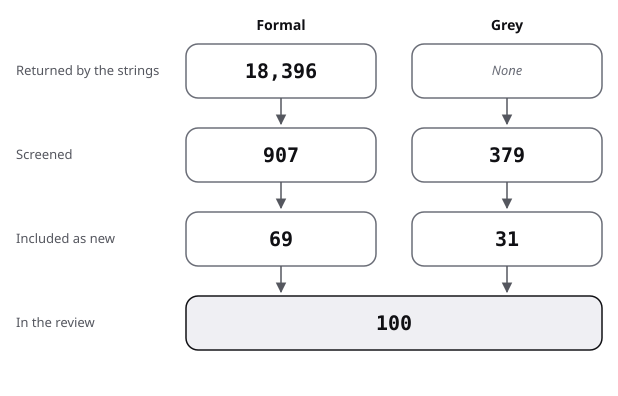

# Sources: the pool, the flow and the scores

The pool of the flashcards review: how it narrowed, then one row per source. Strings and rules: [protocol](protocol.md).
Full citations are in the [bibliography](../bibliography.md).

## Flow

| Stage | Formal | Grey |
|---|---|---|
| Returned by the strings | 18,396 | not recorded |
| Screened | 907 | 379 |
| Included as new | 69 | 31 |
| In the review | 69 | 31 |

- Formal, returned: ERIC 1,135 over 39 strings; Semantic Scholar 17,232 over the 33 strings it answered (6 refused, HTTP 429); arXiv 29 over 8 strings. Repeats across strings and databases are not removed.
- Formal, screened by title: 321 ERIC records (the 20 most relevant per string, fewer where fewer were returned), 557 Semantic Scholar records (the 20 most cited per string) and 29 arXiv records. They total 907 in all, with repeats.
- Formal, included: 69 new sources, all absent from the five reader-ergonomics bibliographies. Further works are cited without being reviewed: Garousi 2019 (the method), Rawson 2013 (held by the core), Janes 2020 and Price 2025 (excluded, linked to the core). Also: eight records read or located and not used (below).
- Grey, web: 121 results screened over 7 strings and 18 pages visited directly, 139 in all; 12 sources included.
- Grey, Q/A: 240 records returned and screened over 14 strings; 19 threads included.
- Exclusion reasons were not counted record by record. In rough order of frequency:
  - off topic: statistics and medical textbooks, neuroscience of paired-associate stimulation, computer vision ("image occlusion"), information theory ("minimum information principle"), genetics and politics ("generation");
  - studies of whether an app, testing or spacing works, with nothing on how cards are written or used: the core's question (for example many Quizlet effect studies);
  - single-case flashcard drills for children with disabilities, and early reading of sight words;
  - schedulers and memory models, linked to the core's benchmark;
  - read by abstract and adding nothing beyond an included source: Nakata 2008, Dizon 2017, Kaplan-Rakowski 2017, Zhang 2022, Yüksel 2022, Plantak 2026;
  - not readable: the WikiFlash study named in a search summary (Semantic Scholar refused the lookup; not verified). Reynolds 2019 on student-made word cards, and Rawson 2007, received by handoff, are both title only (no abstract reached).
- Works of other topics are listed in [handoff](handoff.md).
- Existing reviews found: 11, placed in review.md strand 0.

The figure draws the stages of the table for flashcards (`flow.json`).

## Formal sources

Quality is the kind of evidence and how far it was read; the grade of each claim is in the [README](README.md).

| Key | Kind | Found via | Quality | Used in |
|---|---|---|---|---|
| Bachiri 2025 | formal | F2 | quasi-experiment, generated cards; abstract | review 7 |
| Balepur 2024 | formal | X1 | preference study, 45 students; preprint, abstract | review 7; against |
| Barhdaoui 2026 | formal | F2 | randomised within-participant, 337 offered, 79 completed; abstract | against |
| Bertsch 2007 | formal | F12; brief lead | meta-analysis, 86 studies; abstract | review 1, 3; position; protocol |
| Bjork 2013 | formal | narrative, verified | review; abstract | review 0; frame; protocol |
| Bow 2013 | formal | F20 | cohort comparison, one school; abstract | review 3 |
| Carpenter 2012 | formal | F30 | four experiments; abstract | review 2; state-of-the-art; position; against |
| Deng 2015 | formal | F4; brief lead | retrospective survey, 72 students; full text | review 3; state-of-the-art; position; against; protocol |
| Garousi 2019 | formal | method | method paper, carried from the bibliographies | protocol |
| Gilbert 2023 | formal | F3 | cohort, 130 students; abstract | review 8; state-of-the-art; against |
| Golding 2012 | formal | F25 | survey with exam scores, 415 students; abstract | review 4; state-of-the-art |
| Griffin 1996 | formal | narrative, verified | experiment, school pupils; abstract | review 2; state-of-the-art; position |
| Halperin 2024 | formal | F4; G4 | measured, descriptive: survey, 560 students; abstract | review 8; state-of-the-art; against; protocol |
| Harris 2022 | formal | F4 | measured, descriptive: survey, 60 students; abstract | review 8 |
| Hartwig 2012 | formal | brief lead | measured, descriptive: survey, 324 students; abstract | state-of-the-art; position; protocol |
| Ide 2026 | formal | F19 | two experiments; abstract | review 2; state-of-the-art; position |
| Imundo 2025 | formal | F15 | three experiments; abstract | review 4 |
| Ingebrigtsen 2025 | formal | F3 | campus-randomised quasi-experiment, 799 students; abstract | review 3; state-of-the-art; against; baseline |
| Ishii 2015 | formal | F17 | experiment, replication; abstract | review 5; state-of-the-art; position; against |
| Janes 2020 | formal | F28 | course experiments; excluded, linked to the core | protocol |
| Kang 2016 | formal | F2 | review; abstract | review 0; protocol |
| Karpicke 2009 | formal | narrative, verified | four experiments; abstract | review 4; state-of-the-art; position |
| Karrar 2026 | formal | F25 | quasi-experiment, 60 learners; abstract | review 7; against |
| Khurana 2025 | formal | G2 | quasi-experiment, preprint; abstract | review 7; state-of-the-art; position; against; protocol |
| Kim 2023 | formal | F16 | experiment, 150 learners; abstract | review 2; state-of-the-art; position; protocol |
| Kornell 2007 | formal | snowball (Hartwig 2012) | review; abstract | review 0; protocol |
| Kornell 2008 | formal | F15; brief lead | four experiments; abstract | review 4; state-of-the-art; position; baseline; frame; protocol |
| Kornell 2009 | formal | F16; brief lead | three experiments; abstract | review 4; state-of-the-art; position; protocol |
| Kornell 2009b | formal | F15 | two experiments; abstract | review 4 |
| Lee 2023 | formal | X1 | experiment against hand-made cues; preprint, abstract, no numbers | review 7 |
| Lei 2022 | formal | F23 | research synthesis, 32 studies, not pooled; abstract | review 0, 3; state-of-the-art; position; against |
| Levy 2023 | formal | F4 | cohort, 45 students; abstract | review 8; against |
| Li 2026 | formal | X1 | design study, 6 students; preprint, abstract | review 7 |
| Lin 2018 | formal | F13 | two experiments; abstract | review 5; state-of-the-art; position; against; baseline |
| Lu 2021 | formal | F4; brief lead | retrospective survey, 201 students; full text | review 3; state-of-the-art; position; against; baseline; frame; protocol |
| Makus 2023 | formal | F4 | measured, descriptive: survey, 57 students; abstract | review 8 |
| McCurdy 2020 | formal | narrative, verified | meta-analysis, 310 experiments; abstract | review 3; position; against; protocol |
| Nairne 2002 | formal | F11 | theory; title and venue only | review 1; frame |
| Nakata 2011 | formal | F19; F36 | review of nine programs; abstract | review 0; position; frame; protocol |
| Nakata 2016 | formal | snowball (Crossref query) | two experiments; abstract | review 5; state-of-the-art; position; frame; protocol |
| Nakata 2017 | formal | F36 | experiment, 98 learners; abstract | review 5; baseline |
| Nakata 2019 | formal | F17 | experiment, 133 learners; abstract | review 5; state-of-the-art; position; against; baseline |
| Nakata 2019b | formal | F23 | handbook chapter; not opened | review 0 |
| Nation 2000 | formal | snowball (LLSE 2018b) | review; not opened | review 5; against; protocol |
| Nguyen 2021 | formal | F4 | narrative review; abstract | review 0; protocol |
| Öcel 2025 | formal | F5 | systematic review, 25 studies; abstract | review 0; position; protocol |
| Pan 2023b | formal | F13; brief lead | six experiments; abstract | review 3; state-of-the-art; position; against; baseline; protocol |
| Price 2025 | formal | F20 | randomised cohort, 26,258 physicians; excluded, linked to the core | protocol |
| Pyc 2011 | formal | F15 | two experiments; abstract | review 4; state-of-the-art; position |
| Rawson 2013 | formal | core | carried from the core, not reviewed | protocol |
| Reynolds 2020 | formal | F23 | classroom study, 50 students; abstract | review 2 |
| Sage 2019 | formal | F24 | experiment; abstract | review 3; against |
| Santos-Ferreira 2024 | formal | F1 | cohort, dose-response; abstract | review 3 |
| Schindler 2023 | formal | F31 | meta-analysis; abstract | review 3; against; protocol |
| Schindler 2024 | formal | F12 | direct replication; abstract | against |
| Schindler 2025 | formal | F12 | seven experiments, conceptual replication; abstract | against |
| Schmidmaier 2011 | formal | F20 | randomised, 80 students; abstract | against |
| Seibert Hanson 2020 | formal | F2; F4 | course study, 62 learners; abstract | review 4; against; baseline |
| Senzaki 2017 | formal | F18 | three course studies, one cluster-randomised; abstract | review 5; state-of-the-art; position; against; baseline |
| Slamecka 1978 | formal | F12; brief lead | experiments; title and venue only | review 1; frame; protocol |
| Sun 2021b | formal | F13 | cohort, 101 students; abstract | review 3; against |
| Teymouri 2024 | formal | F18; F24 | mini review; abstract | review 0; protocol |
| Tinkham 1993 | formal | F17 | two experiments; abstract | review 5; frame |
| Tinkham 1997 | formal | F17 | experiments; abstract | review 5; state-of-the-art |
| Tullis 2022 | formal | F31 | two experiments; abstract | review 3 |
| Versteeg 2020 | formal | narrative, verified | scoping review, 120 articles; abstract | review 0; position; protocol |
| Watkins 1975 | formal | F11 | experiments; title and venue only | review 1; frame |
| Webb 2020 | formal | F15; F22 | meta-analysis, 22 studies; abstract | review 0; position; protocol |
| Wilkinson 2020 | formal | F23 | two experiments; abstract | review 3; against; frame |
| Wissman 2012 | formal | F15; brief lead | measured, descriptive: survey, 374 students; abstract | review 4; protocol |
| Wothe 2023 | formal | F4 | measured, descriptive: survey, 165 students; abstract | review 8; state-of-the-art; against |
| Xu 2024c | formal | F25 | systematic review; abstract | review 0; position; protocol |
| Zung 2022 | formal | F15; brief lead | measured, descriptive: survey, 901 students; abstract | review 4; frame; protocol |

## Grey sources, scored

Subtotals in the order of the [shared rules](../README.md#rules-the-four-reviews-share).

| Key | Kind | Found via | Quality (total, then subtotals) | Used in |
|---|---|---|---|---|
| Wozniak 1999 | grey tier 2 | P; brief lead | 13 of 20 (3.5 / 3 / 1.5 / 1 / 0.5 / 2 / 1 / 0.5) | review 1; state-of-the-art; position; against; baseline; frame; protocol |
| Matuschak 2020 | grey tier 3 | P; brief lead | 15 of 20 (3 / 4 / 3 / 1 / 1 / 2 / 1 / 0) | review 2; state-of-the-art; position; against; baseline; protocol |
| Nielsen 2018 | grey tier 3 | P; brief lead | 15.5 of 20 (3.5 / 4 / 3 / 1 / 1 / 2 / 1 / 0) | review 2, 3, 8; state-of-the-art; frame; protocol |
| Nielsen 2019 | grey tier 3 | P | 13 of 20 (3.5 / 3 / 3 / 1 / 0.5 / 1.5 / 0.5 / 0) | review 5; frame |
| Matuschak 2019 | grey tier 3 | P; brief lead | 16 of 20 (3.5 / 4.5 / 3 / 1 / 1 / 2 / 1 / 0) | review 6; state-of-the-art; position; against; frame; protocol |
| Branwen 2019 | grey tier 3 | P | 14 of 20 (2.5 / 4 / 3 / 1 / 1 / 1.5 / 1 / 0) | review 8; state-of-the-art; against |
| Bjornstad 2020 | grey tier 3 | P | 10.5 of 20 (1.5 / 2.5 / 3 / 1 / 1 / 1 / 0.5 / 0) | review 2; state-of-the-art; against; frame |
| Anki 2026a | grey tier 2 | P; brief lead | 11.5 of 20 (3.5 / 2.5 / 2.5 / 0 / 0.5 / 1 / 1 / 0.5) | review 2, 3; state-of-the-art; baseline; frame; protocol |
| Anki 2026b | grey tier 2 | P | 9 of 20 (3.5 / 1.5 / 2 / 0 / 0 / 0.5 / 1 / 0.5), example only | against |
| Anki 2026c | grey tier 2 | P | 12 of 20 (3.5 / 2.5 / 2.5 / 0 / 1 / 1 / 1 / 0.5) | review 2, 4; state-of-the-art; against; baseline; frame |
| Wyner 2014 | grey tier 1 | G5 | 8.5 of 20 (2 / 1 / 1.5 / 1 / 0 / 1 / 1 / 1), example only | against; protocol |
| Wikipedia 2026e | grey tier 2 | G1 | 9.5 of 20 (1.5 / 2 / 2.5 / 1 / 0.5 / 0.5 / 1 / 0.5), example only | review 8; state-of-the-art; protocol |
| LLSE 2016a | grey tier 2 | FC1 | 11.5 of 20 (1 / 3 / 3.5 / 1 / 0.5 / 1.5 / 0.5 / 0.5) | review 8 |
| LLSE 2016b | grey tier 2 | FC1 | 11 of 20 (0.5 / 3.5 / 3.5 / 1 / 0 / 1.5 / 0.5 / 0.5) | review 8; against |
| LLSE 2016c | grey tier 2 | FC2 | 11.5 of 20 (0.5 / 3.5 / 3.5 / 1 / 0.5 / 1.5 / 0.5 / 0.5) | review 8 |
| LLSE 2016d | grey tier 2 | FC2 | 11.5 of 20 (0.5 / 4 / 3.5 / 1 / 0.5 / 1.5 / 0 / 0.5) | review 8 |
| LLSE 2016e | grey tier 2 | FC2 | 13 of 20 (1.5 / 4 / 3.5 / 1 / 1 / 1 / 0.5 / 0.5) | review 8 |
| LLSE 2016f | grey tier 2 | FC1 | 10 of 20 (0.5 / 3 / 3.5 / 1 / 0 / 1.5 / 0 / 0.5) | review 8 |
| LLSE 2016g | grey tier 2 | FC2 | 9.5 of 20 (0.5 / 2.5 / 3.5 / 1 / 0 / 1 / 0.5 / 0.5), example only | review 8 |
| LLSE 2016h | grey tier 2 | FC1 | 12.5 of 20 (1 / 4 / 3.5 / 1 / 0.5 / 1.5 / 0.5 / 0.5) | review 8 |
| LLSE 2017a | grey tier 2 | FC2 | 12 of 20 (1 / 3.5 / 3 / 1 / 1 / 1.5 / 0.5 / 0.5) | review 8; against |
| LLSE 2017b | grey tier 2 | FC1 | 13 of 20 (1.5 / 4 / 3.5 / 1 / 1 / 1.5 / 0 / 0.5) | review 2 |
| LLSE 2018a | grey tier 2 | FC1 | 12.5 of 20 (1.5 / 3.5 / 3.5 / 1 / 0.5 / 1.5 / 0.5 / 0.5) | review 8 |
| LLSE 2018b | grey tier 2 | FC3 | 13 of 20 (1.5 / 4 / 3.5 / 1 / 1 / 1.5 / 0 / 0.5) | review 5; protocol |
| PNSE 2015 | grey tier 2 | FC3 | 13 of 20 (2 / 3.5 / 3.5 / 1 / 1 / 1.5 / 0 / 0.5) | review 2 |
| PNSE 2016 | grey tier 2 | FC1 | 9 of 20 (0.5 / 2.5 / 3 / 1 / 0.5 / 1 / 0 / 0.5), example only | review 8 |
| MESE 2014 | grey tier 2 | FC1 | 13.5 of 20 (2 / 4 / 3.5 / 1 / 0.5 / 1.5 / 0.5 / 0.5) | review 8; against |
| MESE 2024 | grey tier 2 | FC1 | 10.5 of 20 (1.5 / 3 / 3.5 / 1 / 0 / 1 / 0 / 0.5) | review 8 |
| AcSE 2016 | grey tier 2 | FC3 | 13 of 20 (2 / 3 / 3.5 / 1 / 0.5 / 1.5 / 1 / 0.5) | review 8 |
| AcSE 2023 | grey tier 2 | FC9 | 11 of 20 (2 / 3 / 3.5 / 1 / 0 / 1 / 0 / 0.5) | review 8 |
| AcSE 2024 | grey tier 2 | FC3 | 12.5 of 20 (1.5 / 3 / 3.5 / 1 / 0.5 / 1.5 / 1 / 0.5) | review 8; against |

## Result of the scoring

- 31 grey sources scored: 12 from the web, 19 Q/A threads.
- 5 fall below 10 of 20: Anki 2026b, Wyner 2014, Wikipedia 2026e, LLSE 2016g and PNSE 2016; they appear only as examples of practice.
- LLSE 2016f sits exactly at 10 and stays in.
- The highest scores go to two practitioner essays that report their own data and limits (Matuschak 2019, 16; Nielsen 2018, 15.5).
- Personal essays score 0 on outlet (tier 3), so their totals rest on authority, method and novelty.
- GitHub 2026h is the reviewer's own count of public listings, not a source, so it is not scored.
- One scorer; no second rater on this topic.
