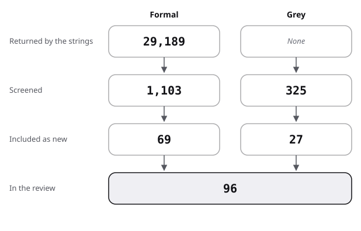

# Sources: the pool, the flow and the scores

The pool of the instructional-text review: how it narrowed, then one row per source. Strings and rules: [protocol](protocol.md).

## Flow

| Stage | Formal | Grey |
|---|---|---|
| Returned by the strings | 29,189 | not recorded (web); 233 (Q/A) |
| Screened | 1,103 | 325 |
| Included as new | 69 | 27 |
| In the review | 69 | 27 |

- Formal:
  - 29,189 records were returned: ERIC 3,835 over 43 strings, Semantic Scholar 25,354 over 24 strings; the two overlap.
  - 1,103 titles were screened: 668 in ERIC and 435 in Semantic Scholar (the top 20 by citations).
  - The audit found that the rule as stated, the top 20 ERIC records per string, gives 727 over the protocol's table, so 1,162 in all. The count of 668 was kept as recorded; the difference was not resolved.
  - 69 were included as new; none of them is in the five bibliographies of the reader-ergonomics repositories.
  - Works already reviewed elsewhere are linked, not counted (frame.md, last table).
- Grey:
  - The web strings showed 78 results and 14 pages were visited directly; the Q/A strings returned 233 threads.
  - 325 were screened (92 web, 233 Q/A).
  - 27 were included: 13 from the web and from books, 14 Q/A threads.
  - 2 further threads met here are reviewed in the exercise-sets review and only linked (last line of the grey table).
- Formal exclusions, estimated by title and rounded to tens:
  - repeats across strings and databases: about 150;
  - off topic (language course books, physics and engineering under the same words, bibliographies called "CRIB sheets", textbook catalogues): about 780;
  - another topic of this repository (end-of-chapter question levels, quizzing, flashcards, access to solutions): about 60, see handoff.md;
  - effects the core already holds (adjunct questions, signalling, rereading): about 20;
  - located but not read: about 10.
- Grey exclusions, rounded:
  - web: copies of the same textbook preface on other sites (8), retail listings of solved-problem books (about 20), pages refused (2), off topic (about 40);
  - Q/A: threads of another topic (answer keys, published solutions, practice exams: 7), threads with no answer (2), popular off-topic threads matched by a word in the body (about 210).
- Added by snowballing: Weiten 1996 (named in Marek 1999) and Wiggins 2005 (cited in Wilson 2019). Also, four meta-analyses reached from one web search for Guzzetti 1993 (Danielson 2025, Armagan 2017, Aleknavičiūtė 2023, Pacaci 2024), each then checked in Crossref or ERIC. Gurung 2012 came from a web search for the lead Gurung and Daniel (2005).

## Formal sources

Levels as in review.md. "abstract" means only the abstract was read; "read" means the full text was read for the numbers cited; "located" means title and venue only.

| Key | Kind | Found via | Quality | Used in |
|---|---|---|---|---|
| Hartley 1976 | formal | lead (ERIC) | R, abstract | review 0; position |
| Melton 1978 | formal | lead (ERIC) | R, abstract | review 0; position |
| Hamilton 1985 | formal | lead (ERIC) | R, abstract | review 0; position |
| Tippett 2010 | formal | F11 | R, abstract | review 0; position |
| Guzzetti 1993 | formal | lead (ERIC) | MA, abstract | review 0 |
| Schroeder 2022 | formal | F11 | MA, read (full text, PMC8784251) | review 0; state-of-the-art; position; against; baseline |
| Danielson 2025 | formal | snowball, F35 | MA, abstract (secondary) | review 0; state-of-the-art; position |
| Zengilowski 2021 | formal | F11 | R, abstract | review 0; state-of-the-art; against; baseline |
| Konrad 2009 | formal | F14 | MA, abstract | review 0, 6 |
| Larwin 2012 | formal | F14 | MA, read | review 6; against |
| Larwin 2013 | formal | F14 | MA, read | review 6; state-of-the-art; position; against; baseline |
| Biggers 2020 | formal | F14 | SR, abstract and table read | review 6 |
| Wittwer 2010 | formal | F19 | MA, abstract | review 0, 7; state-of-the-art; position; against |
| Yanagisawa 2020 | formal | F32b | MA, abstract (secondary) | review 0, 4; state-of-the-art; position; against |
| Abraham 2008 | formal | F32b | MA, abstract | review 0, 4 |
| Clinton 2019 | formal | F24 | MA, read | review 0; state-of-the-art; against; baseline |
| Aleknavičiūtė 2023 | formal | snowball | MA, located | review 0 |
| Pacaci 2024 | formal | snowball | MA, located | review 0 |
| Armagan 2017 | formal | snowball | MA, abstract (secondary) | review 0, 5; against |
| Hartley 1977 | formal | F3 | A, abstract | review 1; frame |
| Biggs 1996 | formal | F4 | A, abstract | review 1; frame |
| Cohen 1987 | formal | F6 | A, abstract | review 1; against |
| Krathwohl 2002 | formal | lead (Crossref) | A, located | review 1; frame |
| Weiten 1996 | formal | snowball (Marek 1999) | D, located | review 2 |
| Weiten 1999 | formal | F1 | D, abstract | review 2; state-of-the-art; position; baseline |
| Marek 1999 | formal | F1 | D, abstract | review 2; position; baseline |
| Gurung 2003 | formal | F1 | C, abstract (secondary) | review 2; state-of-the-art; position; against; baseline |
| Gurung 2004 | formal | F1 | C, abstract (secondary) | review 2; state-of-the-art; against; baseline |
| Gurung 2011 | formal | F1 | C, abstract | review 2 |
| Landrum 2012 | formal | F1 | C, abstract | review 2; against |
| Gurung 2012 | formal | web search for a lead | C, located (search summary) | review 2 |
| Benbassat 2008 | formal | F31 | D and E, abstract (secondary) | review 2; position; against |
| Duchastel 1979 | formal | F7 | E, abstract | review 3; position |
| Britton 1985 | formal | F7 | E, abstract | review 3; state-of-the-art; position |
| Kaplan 1974 | formal | F7 | E, abstract | review 3 |
| Stokes 2010 | formal | F7; F29 | D, abstract | review 3; position |
| Larkin 2013 | formal | F4 | C, abstract | review 3; state-of-the-art; position |
| Hailikari 2022 | formal | F4 | C, abstract | review 3; against |
| Trigwell 2014 | formal | F4 | C, abstract | review 3 |
| Wang 2013 | formal | lead (Crossref) | C, located | review 3 |
| Loughlin 2021 | formal | F4 (review terms) | A, abstract | against |
| Polikoff 2014 | formal | F6 | C, abstract | review 3; position; against |
| Lynch 2020 | formal | F34 | C, abstract | review 3; state-of-the-art; position; against |
| Hollowell 2017 | formal | F17 | D, abstract | review 3; position |
| Sadaf 2019 | formal | F34 | D, abstract | review 3 |
| Hartley 1979 | formal | F9 | E, abstract | review 4; state-of-the-art; position; against |
| Cook 1981 | formal | F9 | E, abstract | review 4; state-of-the-art; position; against |
| Reder 1980 | formal | lead (Crossref) | E, read in full (through the university, 2026-10-29) | review 4; against |
| Mayer 1996 | formal | F9; F30 | E, abstract | review 4; state-of-the-art; position; baseline |
| van der Meij 2012 | formal | F9 | E, abstract (secondary) | review 4; state-of-the-art; against |
| Stewart 1991 | formal | F21 | E, abstract | review 4; against |
| Guzzetti 2000 | formal | F12 | R, abstract | review 5; state-of-the-art; against |
| Diakidoy 2011 | formal | F11 | E, abstract | review 5 |
| Jin 2025b | formal | F12 | E, abstract | review 5; against; baseline |
| Jin 2024 | formal | F12 | E, abstract | review 5; against |
| Dickson 2005b | formal | F15 | E, abstract | review 6; state-of-the-art; position; against |
| Horner 2007 | formal | F15 | E, abstract | review 6; position; against |
| Cushen 2019 | formal | F15 | E, abstract | review 6; state-of-the-art; position; against |
| Saleh 2026 | formal | F15 | C, abstract | review 6 |
| Lieu 2017 | formal | F15 | C, abstract | review 6 |
| Duchastel 1983 | formal | lead (ERIC) | A, abstract | review 6 |
| Dickson 2008 | formal | F16 | E, abstract | review 6; state-of-the-art; position; against |
| Funk 2011 | formal | lead (ERIC) | E, abstract | review 6; state-of-the-art; position; against |
| Burns 2014 | formal | F15 | C, abstract | review 6 |
| Hamouda 2016 | formal | F16 | C, abstract | review 6 |
| Wittwer 2008 | formal | F19 | R, abstract | review 7 |
| Richey 2013 | formal | F19; F33 | E, abstract | review 7; position; against |
| Gerjets 2006 | formal | F33 | E, abstract | review 7; against |
| Mendiolea 2013 | formal | F20 | D, abstract | review 7 |

## Grey sources, scored

Subtotals in the order of the [shared rules](../README.md#rules-the-four-reviews-share).

| Key | Kind | Found via | Quality (total, then subtotals) | Used in |
|---|---|---|---|---|
| Wilson 2019 | grey tier 1 | P; F5 lead | 17.5 of 20 (4 / 5 / 3 / 1 / 1 / 1.5 / 1 / 1) | review 8; frame; state-of-the-art; position |
| Hartley 1978 | grey tier 1 | F3 | 11 of 20 (4 / 2.5 / 0.5 / 1 / 0 / 1 / 1 / 1) | review 1; frame |
| Mager 1962 | grey tier 1 | F7 | 11 of 20 (4 / 2.5 / 0 / 1 / 0 / 1.5 / 1 / 1) | review 1; frame |
| Wiggins 2005 | grey tier 1 | snowball (Wilson 2019) | 8 of 20 (4 / 0 / 0 / 1 / 0 / 1 / 1 / 1), book not opened | frame; review 1 (example only, the method's name) |
| OpenStax 2026b | grey tier 1 | G1 | 10.5 of 20 (3.5 / 2.5 / 1.5 / 0 / 0 / 1 / 1 / 1) | review 8; state-of-the-art; position; against; baseline |
| OpenStax 2026c | grey tier 2 | P | 8 of 20 (3.5 / 2 / 0.5 / 0 / 0 / 0.5 / 1 / 0.5) | state-of-the-art; against (example only) |
| Carpentries 2026a | grey tier 2 | P | 14.5 of 20 (4 / 4 / 3.5 / 0 / 0.5 / 1 / 1 / 0.5) | review 8; state-of-the-art; position; baseline |
| Carpentries 2026b | grey tier 2 | P | 15 of 20 (4 / 4.5 / 3.5 / 0 / 0.5 / 1 / 1 / 0.5) | review 8; frame; state-of-the-art; position |
| Carpentries 2025 | grey tier 2 | G2 | 11.5 of 20 (4 / 3 / 1.5 / 1 / 0 / 0.5 / 1 / 0.5) | review 8; state-of-the-art; baseline |
| Quality Matters 2026a | grey tier 2 | P | 8.5 of 20 (3.5 / 2 / 1 / 0 / 0 / 0.5 / 1 / 0.5) | state-of-the-art; against (example only) |
| Quality Matters 2026b | grey tier 2 | P | 11 of 20 (3.5 / 3.5 / 1.5 / 0 / 0 / 1 / 1 / 0.5) | review 8; frame; state-of-the-art; position |
| SUNY 2026 | grey tier 2 | P | 9.5 of 20 (3 / 2.5 / 2.5 / 0 / 0 / 0.5 / 0.5 / 0.5) | review 8; against (example only) |
| CMU 2025 | grey tier 2 | P | 11.5 of 20 (4 / 3 / 2.5 / 0 / 0.5 / 0.5 / 0.5 / 0.5) | review 8; frame |
| MathEd 2014h | grey tier 2 | IT7 | 12 of 20 (2 / 4 / 3 / 1 / 0 / 1 / 0.5 / 0.5) | review 8; against |
| MathEd 2014i | grey tier 2 | IT7 | 10.5 of 20 (1.5 / 3 / 3 / 1 / 0 / 1 / 0.5 / 0.5) | review 8 |
| MathEd 2014j | grey tier 2 | IT7 | 8 of 20 (0.5 / 2.5 / 2.5 / 1 / 0.5 / 0.5 / 0 / 0.5) | review 8 (example only) |
| MathEd 2014k | grey tier 2 | IT6 | 15 of 20 (2 / 5 / 3.5 / 1 / 0.5 / 1.5 / 1 / 0.5) | review 8 |
| MathEd 2014l | grey tier 2 | IT6 | 9 of 20 (1 / 3 / 2.5 / 1 / 0 / 1 / 0 / 0.5) | review 8; against (example only) |
| MathEd 2017b | grey tier 2 | IT8 | 12 of 20 (1.5 / 4 / 3.5 / 1 / 0.5 / 1 / 0 / 0.5) | review 8 |
| MathEd 2017c | grey tier 2 | IT4 | 12 of 20 (2.5 / 3.5 / 3 / 1 / 0 / 1 / 0.5 / 0.5) | review 8 |
| Academia 2014a | grey tier 2 | IT7 | 14.5 of 20 (2.5 / 4.5 / 3.5 / 1 / 0.5 / 1 / 1 / 0.5) | review 8 |
| Academia 2017b | grey tier 2 | IT5 | 11.5 of 20 (2.5 / 3.5 / 3 / 1 / 0.5 / 0.5 / 0 / 0.5) | review 8 |
| Academia 2017c | grey tier 2 | IT7 | 13 of 20 (2.5 / 4 / 3 / 1 / 0.5 / 1 / 0.5 / 0.5) | review 8; against |
| Academia 2018b | grey tier 2 | IT4 | 11.5 of 20 (2.5 / 3 / 2.5 / 1 / 0 / 1 / 1 / 0.5) | review 8; state-of-the-art |
| Academia 2018c | grey tier 2 | IT11 | 9.5 of 20 (2 / 2 / 3.5 / 1 / 0 / 0.5 / 0 / 0.5) | review 8 (example only) |
| Academia 2022a | grey tier 2 | IT11 | 8 of 20 (0.5 / 2.5 / 2.5 / 1 / 0 / 0.5 / 0.5 / 0.5) | review 8 (example only) |
| CSEd 2018c | grey tier 2 | IT1 | 12 of 20 (2.5 / 3.5 / 3 / 1 / 0.5 / 1 / 0 / 0.5) | review 8 |

- MathEd 2021a and MathEd 2022b (published solutions, IT9) were found here and are reviewed in the exercise-sets review; they are linked from review.md strand 7 and not scored again.

## Result of the scoring

- 27 grey sources scored here: 13 from the web and books, 14 Q/A threads.
- 8 fall below 10 of 20: Wiggins 2005, OpenStax 2026c, Quality Matters 2026a, SUNY 2026, MathEd 2014j, MathEd 2014l, Academia 2018c, Academia 2022a. They appear only as examples of practice.
- The adoption figures of OpenStax and Quality Matters are among those below the threshold: they are their owners' undated claims.
- The highest scores go to a practitioner book with references (Wilson 2019) and to the Carpentries lesson training (Carpentries 2026b).
- Books known only from their ERIC records (Hartley 1978, Mager 1962) score 0 on the parts not seen.
