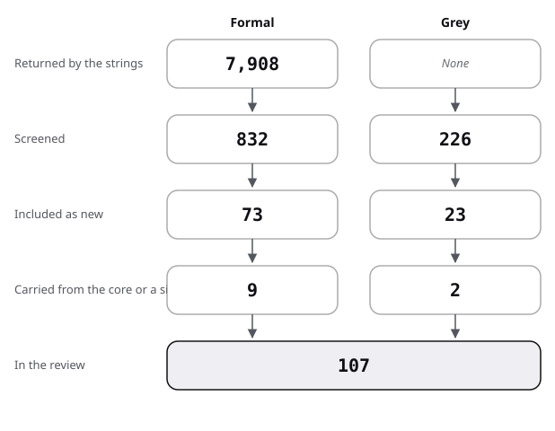

# Sources: the pool, the flow and the scores

The pool of the practice-questions review: how it narrowed, then one row per source. Strings and rules: [protocol](protocol.md).

## Flow

| Stage | Formal | Grey |
|---|---|---|
| Returned by the strings | 7,908 | not recorded (web); 172 (Q/A) |
| Screened | 832 | 226 |
| Included as new | 73 | 23 |
| Carried from the core or a sibling review | 9 | 2 |
| In the review | 82 | 25 |

- Formal:
  - 7,908 records were returned (ERIC 1,298; Semantic Scholar 6,515; arXiv 95), with repeats across strings.
  - 832 were screened by title (ERIC 517; Semantic Scholar 254; arXiv 61).
  - 73 were included as new, 3 of them located by title only (Kang 2007, McDaniel 2007, McDermott 2014).
  - 9 core works are cited for their moderators or as links (Rowland 2014, Yang 2021, Adesope 2017, Hamaker 1986, St. Hilaire 2023, Bisra 2018, Alemdag 2025, van Gog 2015, Karpicke 2015); Garousi 2019 is the method.
- Grey:
  - The web strings returned 39 results and the producer visits 15 pages; the Q/A strings returned 172 records.
  - 226 were screened (54 web, 172 Q/A).
  - 23 were included as new (8 web, 15 Q/A threads); 2 are carried from sibling reviews (Pashler 2007 from exercise-sets; OpenStax 2026c from instructional-text).
- Formal exclusions, counted by title and rounded to tens:
  - repeats across strings: 120;
  - re-measures of the testing effect held in the core: 90;
  - assessment scoring, equating and adaptive testing (most of F14, F27): 150;
  - question generation for machine reading, no learner (X1 to X3): 50;
  - off topic (medicine, engineering, language corpora, physics): 300;
  - other topics, passed to handoff.md: 10;
  - relevant, abstract not reachable: 20.
- Grey exclusions: known sources seen again 10; pages of other topics 15; cheating, grading and policy threads 140; homework and solution threads, passed to exercise-sets 5; one 404 page.
- Added by snowballing: Kulhavy 1977, Kulik 1988 and Bangert-Drowns 1991 (from Hattie 2007, also returned by F13 and F20b); Kang 2007 (from Pan 2018); McDermott 2014 (from Yang 2021).
- Existing reviews found: 20, listed in review.md strand 0.

## Formal sources

Grade vocabulary: MA meta-analysis; R review; E experiment; C classroom or field study; D descriptive count; T tool or system study. "abstract" names how it was read.

| Key | Kind | Found via | Quality | Used in |
|---|---|---|---|---|
| Pan 2018 | formal | F18b; lead (brief) | MA, 192 effects, full text | review 0, 1; state-of-the-art; position; baseline |
| Wisniewski 2020 | formal | F13; lead (brief) | MA, 994 effects, full text | review 0, 4; state-of-the-art; against |
| Van der Kleij 2015 | formal | F13; lead (brief) | MA, 70 effects, abstract | review 0, 4 |
| Mertens 2022 | formal | reviewer lead | network MA, 163 effects, abstract | review 0, 4; state-of-the-art |
| Bangert-Drowns 1991 | formal | snowball; F13 | MA, 58 effects, abstract and secondary | review 0, 4 |
| Kulik 1988 | formal | F13 | MA, 53 studies, abstract | review 0, 4; against |
| Kandemir 2026 | formal | F13 | MA, 160 effects, abstract | review 0, 4; state-of-the-art; against |
| Hattie 2007 | formal | lead (brief) | R, full text | review 0, 4; against |
| Shute 2008 | formal | lead (brief) | R, abstract | review 0; frame |
| Kulhavy 1977 | formal | F20b | R, abstract and secondary | review 0, 5; position; against |
| Andre 1979 | formal | F5 | R, abstract | review 0; frame |
| Haladyna 1989 | formal | F7 | R of 96 studies, abstract | review 0, 3; position; against |
| Haladyna 2002 | formal | F7; lead (brief) | R, 31 guidelines, abstract | review 0, 3; baseline |
| Frey 2005 | formal | F7 | D, 20 textbooks, abstract | review 0, 3 |
| Rodriguez 2005 | formal | F9; lead (brief) | MA, abstract | review 0, 3; state-of-the-art; against |
| Gierl 2017 | formal | F23 | R, abstract | review 0, 3 |
| Kurdi 2020 | formal | F15; lead (brief) | systematic review, 93 papers, abstract | review 0, 6 |
| Gorgun 2024 | formal | F15 | survey, abstract | review 0, 6 |
| Alhazmi 2024 | formal | X3 | survey, abstract | review 0; frame |
| Butler 2018 | formal | lead (brief) | R, read through WashU 2018 (secondary) | review 0, 3; against |
| Agarwal 2019 | formal | F6; lead (brief) | E and C, abstract | review 1; state-of-the-art; position; baseline |
| Jensen 2014 | formal | F18b; lead (brief) | C, one course, abstract | review 1; state-of-the-art; against |
| McDaniel 2013 | formal | reviewer lead | C, middle school, abstract | review 1; position |
| Collins 2018 | formal | F1 | C, abstract | review 1 |
| Butler 2010 | formal | F1 | E, 4 experiments, abstract | review 1; baseline |
| Rohrer 2010 | formal | F18b | E, children, abstract | review 1 |
| Momsen 2010 | formal | reviewer lead | D, 9,713 items, full text | review 1; state-of-the-art; position; baseline |
| Momsen 2013 | formal | F22 | D, abstract | review 1 |
| Davila 2009 | formal | F29 | D, textbooks, abstract | review 1 |
| Smith 2013c | formal | lead (brief) | E, N = 372, abstract | review 2; against; baseline |
| Lawson 2021 | formal | F2 | C, abstract | review 2; against |
| Little 2012 | formal | lead (brief) | E, abstract | review 2; state-of-the-art; against |
| Little 2014 | formal | reviewer lead | E, abstract | review 2, 3; baseline |
| Little 2019 | formal | F26 | E, abstract | review 2 |
| Roediger 2005 | formal | F19 | E, abstract | review 2; against; baseline |
| Marsh 2007 | formal | reviewer lead | R and E, abstract | review 2; against |
| Fazio 2010 | formal | reviewer lead | E, abstract | review 2; against |
| Butler 2008 | formal | F12 | E, abstract | review 2; position; against |
| van den Broek 2023 | formal | F2 | E, 4 experiments, abstract | review 2, 5; against |
| Brom 2026 | formal | F2 | field RCT, N = 13,060, abstract | review 2, 5; against; baseline |
| Smith 2013b | formal | F25 | E, 4 experiments, abstract | review 2, 5 |
| Yu 2025 | formal | F25 | MA, 18 studies, abstract | review 2; state-of-the-art; against |
| Rivers 2025 | formal | F25 | E, 2 experiments, abstract | review 2, 5 |
| Downing 2005 | formal | F8; lead (brief) | D, 4 exams, abstract | review 3; state-of-the-art; against |
| Tarrant 2006 | formal | F8 | D, 2,770 items, abstract | review 3; state-of-the-art; position |
| Tarrant 2008 | formal | F8; lead (brief) | D, 10 papers, abstract | review 3; against |
| Moore 2026 | formal | F8 | D, 1,230 items, abstract | review 3; against |
| Pachai 2015 | formal | F23 | C, abstract | review 3; against |
| Sadler 1998 | formal | lead (brief) | psychometric study, abstract | review 3; baseline |
| Hansen 1997 | formal | F7 | D, 10 test banks, abstract | review 7; position |
| Masters 2001 | formal | reviewer lead | D, 2,913 questions, abstract | review 7; position |
| Butler 2013 | formal | reviewer lead | E, 2 experiments, abstract | review 4; state-of-the-art; baseline |
| Pashler 2005 | formal | reviewer lead | E, N = 258, abstract | review 4 |
| Roelle 2016 | formal | F4 | E, N = 59, abstract | review 4; against |
| Butler 2007 | formal | F14; lead (brief) | E, 2 experiments, abstract | review 4; against |
| Metcalfe 2009 | formal | reviewer lead | E, abstract | review 4; against |
| Candel 2021 | formal | F11 | E, N = 133, abstract | review 4 |
| Lefevre 2016 | formal | reviewer lead | D, 599 learners, abstract | review 4; state-of-the-art; against |
| Anderson 1971 | formal | F20c | E, abstract | review 5; state-of-the-art; baseline |
| Zhang 2016 | formal | F16d | rating study, abstract | review 6 |
| Van Campenhout 2021 | formal | reviewer lead | C, vendor's authors, abstract | review 6; against |
| Johnson 2024 | formal | F15 | D, 5.2 million sessions, vendor's authors, abstract | review 6; state-of-the-art |
| Lu 2021b | formal | F15 | C, 91 students, abstract | review 6; against |
| Laupichler 2023 | formal | reviewer lead | item analysis, 161 students, abstract | review 6; against |
| Law 2025 | formal | F8 | item analysis, 24 doctors, abstract | review 6; against; baseline |
| Chauhan 2025 | formal | F16b | crossover item analysis, 120 students, abstract | review 6; against |
| Kuusemets 2024 | formal | F28 | expert comparison, abstract | review 6 |
| Isley 2026 | formal | X1 | IRT field study, 91 classes, abstract | review 6; state-of-the-art |
| Elkins 2023 | formal | X1 | teacher ratings, preprint, abstract | review 6 |
| Scaria 2024 | formal | X1 | expert ratings, preprint, abstract | review 6 |
| Kang 2007 | formal | snowball (Pan 2018) | title, venue and DOI only | against; protocol |
| McDaniel 2007 | formal | lead (brief) | title, venue and DOI only | against; protocol |
| McDermott 2014 | formal | snowball (Yang 2021) | title, venue and DOI only | protocol |
| Rowland 2014 | formal, core | core | MA, full text for moderators | review 0, 2; state-of-the-art; baseline |
| Yang 2021 | formal, core | core | MA, full text for moderators | review 0, 2, 4; state-of-the-art; baseline |
| Adesope 2017 | formal, core | core | MA, moderators secondary | frame; protocol |
| Hamaker 1986, St. Hilaire 2023, Bisra 2018, Alemdag 2025, van Gog 2015, Karpicke 2015 | formal, core | core | linked, not reviewed again | frame; review 1; against |

## Grey sources, scored

Subtotals in the order of the [shared rules](../README.md#rules-the-four-reviews-share).

| Key | Kind | Found via | Quality (total, then subtotals) | Used in |
|---|---|---|---|---|
| Spielman 2020 | grey tier 1 | P | 15 of 20 (3.5 / 4 / 3.5 / 1 / 0.5 / 0.5 / 1 / 1) | review 7; state-of-the-art; position; baseline |
| Brame 2013 | grey tier 2 | P | 15 of 20 (3.5 / 4 / 3.5 / 1 / 1 / 0.5 / 1 / 0.5) | review 7; position; baseline |
| Carpentries 2026p | grey tier 2 | P | 13 of 20 (3 / 3 / 3.5 / 1 / 0 / 1 / 1 / 0.5) | review 7; state-of-the-art; position |
| Carpentries 2025p | grey tier 2 | G1 | 12.5 of 20 (3.5 / 3.5 / 3.5 / 1 / 0.5 / 1.5 / 0.5 / 0.5) | review 7; position |
| NBME 2026 | grey tier 1 | P | 12 of 20 (4 / 2.5 / 3 / 0 / 0 / 0.5 / 1 / 1) | review 7; state-of-the-art; against |
| Moodle 2025 | grey tier 2 | P | 11.5 of 20 (2.5 / 2.5 / 3 / 1 / 0 / 1 / 1 / 0.5) | frame; review 7; state-of-the-art |
| WashU 2018 | grey tier 2 | G2 | 11 of 20 (3 / 2.5 / 2.5 / 1 / 0.5 / 0.5 / 0.5 / 0.5) | review 3; against |
| Moodle 2026 | grey tier 2 | P | 10.5 of 20 (3 / 2.5 / 2.5 / 0 / 0 / 1 / 1 / 0.5) | review 7; state-of-the-art; protocol; against |
| Pashler 2007 | grey tier 1 | P (carried from exercise-sets) | 18.5 of 20, scored in exercise-sets; recommendations read on the clearinghouse page | review 7 |
| OpenStax 2026c | grey tier 2 | P (carried from instructional-text) | 8 of 20, scored in instructional-text: example only | review 7; state-of-the-art; against |
| MathEd 2020p | grey tier 2 | PQ1 | 14.5 of 20 (2.5 / 4 / 3.5 / 1 / 0.5 / 1.5 / 1 / 0.5) | review 8 |
| MathEd 2018p | grey tier 2 | PQ1 | 13.5 of 20 (1.5 / 4.5 / 4 / 1 / 1 / 1 / 0 / 0.5) | review 8 |
| MathEd 2014p | grey tier 2 | PQ1 | 13 of 20 (1 / 4.5 / 3.5 / 1 / 1 / 1 / 0.5 / 0.5) | review 8 |
| MathEd 2017p | grey tier 2 | PQ1 | 13 of 20 (2.5 / 4 / 3.5 / 1 / 0 / 1.5 / 0 / 0.5) | review 8 |
| CSEd 2018p | grey tier 2 | PQ1 | 13 of 20 (2 / 4 / 3.5 / 1 / 0 / 1.5 / 0.5 / 0.5) | review 8 |
| Academia 2021p | grey tier 2 | PQ2 | 12 of 20 (2 / 3.5 / 3.5 / 1 / 0 / 1 / 0.5 / 0.5) | review 8 |
| MathEd 2016q | grey tier 2 | PQ8 | 11.5 of 20 (1.5 / 4 / 2.5 / 1 / 1 / 1 / 0 / 0.5) | review 8 |
| Academia 2016p | grey tier 2 | PQ1 | 11.5 of 20 (2.5 / 3 / 3 / 1 / 0 / 0.5 / 1 / 0.5) | review 8 |
| Academia 2018p | grey tier 2 | PQ6 | 11 of 20 (2 / 3 / 3.5 / 1 / 0 / 1 / 0 / 0.5) | review 8 |
| MathEd 2016p | grey tier 2 | PQ1 | 10.5 of 20 (1 / 3.5 / 3 / 1 / 0.5 / 1 / 0 / 0.5) | review 8 |
| MathEd 2014q | grey tier 2 | PQ4 | 10.5 of 20 (1.5 / 3 / 2.5 / 1 / 0 / 1.5 / 0.5 / 0.5) | review 8 |
| MathEd 2017q | grey tier 2 | PQ4 | 10.5 of 20 (1.5 / 3 / 3 / 1 / 0 / 1 / 0.5 / 0.5) | review 8; position |
| MathEd 2025p | grey tier 2 | PQ1 | 10.5 of 20 (2 / 3.5 / 3 / 1 / 0 / 0.5 / 0 / 0.5) | review 8 |
| Academia 2016q | grey tier 2 | PQ2 | 10 of 20 (1.5 / 3 / 3 / 1 / 0.5 / 0.5 / 0 / 0.5) | review 8 |
| CSEd 2024p | grey tier 2 | PQ1 | 10 of 20 (2 / 3 / 2.5 / 1 / 0 / 1 / 0 / 0.5) | review 8 |

## Result of the scoring

- 23 new grey sources scored: 8 from the web and 15 Q/A threads; none falls below 10 of 20. Two carried sources keep the scores of their home review; OpenStax 2026c (8 of 20) is an example only.
- Academia 2016q and CSEd 2024p sit exactly at 10 and stay in.
- Q/A threads were scored with the shared rules: authority from a moderated peer-voted site, the answerer's reputation on the day and any stated role; impact from views and the top answer's votes.
- The highest scores go to the federal practice guide (Pashler 2007, scored in exercise-sets), a published open textbook (Spielman 2020) and a teaching-centre guide that cites its research (Brame 2013).
- Spielman 2020 is scored as an instance of the baseline, not for a claim of effect: it is what learners meet.
