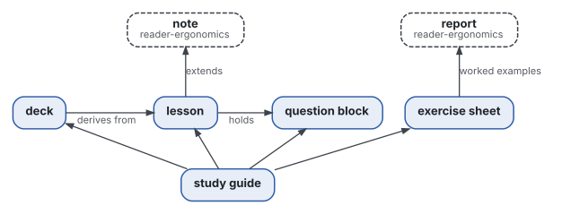

# Shapes

The five shapes of study documents, each derived from the topic of reader-ergonomics-topic and built on the shapes of
reader-ergonomics, with the evidence behind each block and the checks a program runs on it.

## Contents

| Shape | Summary |
|---|---|
| [lesson](lesson.md) | a lesson or chapter studied alone: objectives, the explanation with its traps refuted, a question block per part, key points |
| [question block](question-block.md) | the questions at the end of each part: recall and application, tagged by objective, answers folded and explained |
| [exercise sheet](exercise-sheet.md) | each new type opened by a worked example, then a completion problem and a few problems; a mixed review; hints before answers |
| [deck](deck.md) | flashcards shipped with study material: a header page and a file of cards, one question and one answer, each linked to its section |
| [study guide](study-guide.md) | worked through before an exam: one problem solved per type, traps, variants, an error grid, a date to redo, a method sheet from memory |
| [examples](examples/README.md) | one small document of each shape, on binary search, that passes every check |

## How they fit together



- **Built on, not copied.** The lesson keeps every block of the core
  [note](https://github.com/Tewf/reader-ergonomics/blob/d48ffbe96aed32dd63e1974ee60f69472fe36932/shapes/note.md); a
  worked example is the core [report](https://github.com/Tewf/reader-ergonomics/blob/d48ffbe96aed32dd63e1974ee60f69472fe36932/shapes/report.md),
  with its plan, its steps named by their goal and its fading.
- Every shape is a topic: a title, a summary, a body, contents and see also
  ([topic](https://github.com/Tewf/reader-ergonomics-topic/blob/1220def7863b5e977a3edd1e30bd168fff1523a5/shapes/topic.md)).
  The question block alone is a part, not a document.

## The markup the checks read

Plain Markdown, so a document renders the same on GitHub, in Quarto and in Obsidian.

| Thing | Written as |
|---|---|
| an objective | `- **O1** <verb> ...` under `## Objectives` |
| a question | `1. **O1** <question>` under a `Check yourself` heading, or a callout holding its answer, `> [!QUESTION]- Check: <question>` |
| a folded answer | `<details><summary>Answer</summary> ... </details>`, an Obsidian callout `> [!answer]-`, or a Quarto callout with `collapse="true"` |
| a trap | a quote opening `> **Trap:**`, or a callout titled Trap (`> [!warning] Trap`, `title="Trap"`), holding `**Why not:**` |
| a type of problem | `- **T1** <type>` under `## Types` |
| an item of a sheet | `### Worked example (T1): ...`, `### Complete (T1): ...`, `### Problem (T1): ...` |
| a hint, an answer, a solution | folds whose summaries read Hint, Answer, Solution |
| a card | a row of a TSV file: front, back, source, tags |
| the shape a document follows | a line `**Shape:** [lesson](<link to the shape>)` under the summary |

The labels Trap and Why not are tunables in `checks/config.toml`, so a French vault may write Piège and Pourquoi non.

## Tested against study material written before them

The shapes were held out against two bodies of study material written before them, with predictions written before
the count. One is every section of the 17 explained solution books of
[University-Coursework](https://github.com/Tewf/University-Coursework); the other, the S7 notes of the vault that
goes with them.

| In the books | Sections |
|---|---|
| What this tests, If you meet this again, Predict before running | 102, 103 and 101 of 103 |
| a trap, written as a callout titled Trap | 101 of 103, 134 traps |
| a trap carrying a Why not label | 0 of 103 |
| objectives, a question block, a folded answer | 0 of 103 |

- **A section of an explained book is a worked example:** the core report, which is the study guide's part for one
  type of problem. It is not a lesson, and no shape was bent to fit it.
- **The markup changed twice,** to read the authors' own forms. It reads a trap written as a callout, the form of all
  134, and a question written as a callout with its answer inside, the vault's form.
- **The variants live in the vault, by design:** that repository's rules give variants without a solution to the
  notes, not to the books. A book's section and its vault note together hold the study guide's part for one type.
- **The vault, checked with the `questions` check** (no objectives asked of a note): 757 questions in 93 of 1,197
  notes, every one folded; 10 answers are only a key. Its 48 traps, written as callouts titled Piège, refute in
  prose and carry no Pourquoi non label, the one difference between its convention and these shapes'.

## Declaring the documents to check

A repository that uses these shapes names its documents in its `checks/config.toml`, and copies this repository's
`checks/local/` beside its own:

```toml
[lesson]
files = ["notes/**/*.md", "guides/*.md"]

[sheet]
files = ["sheets/*.md"]

[deck]
files = ["decks/*.tsv"]

[questions]                       # notes: the question-block rules, no objectives asked
files = ["S7/**/*.md"]
trap_labels = ["Piège"]
why_labels = ["Pourquoi non"]
```

## See also

The [repository's front page](../README.md), the parent of this folder; [decision 0004](../decisions/0004-five-shapes-and-a-markup.md),
why these five and this markup.
